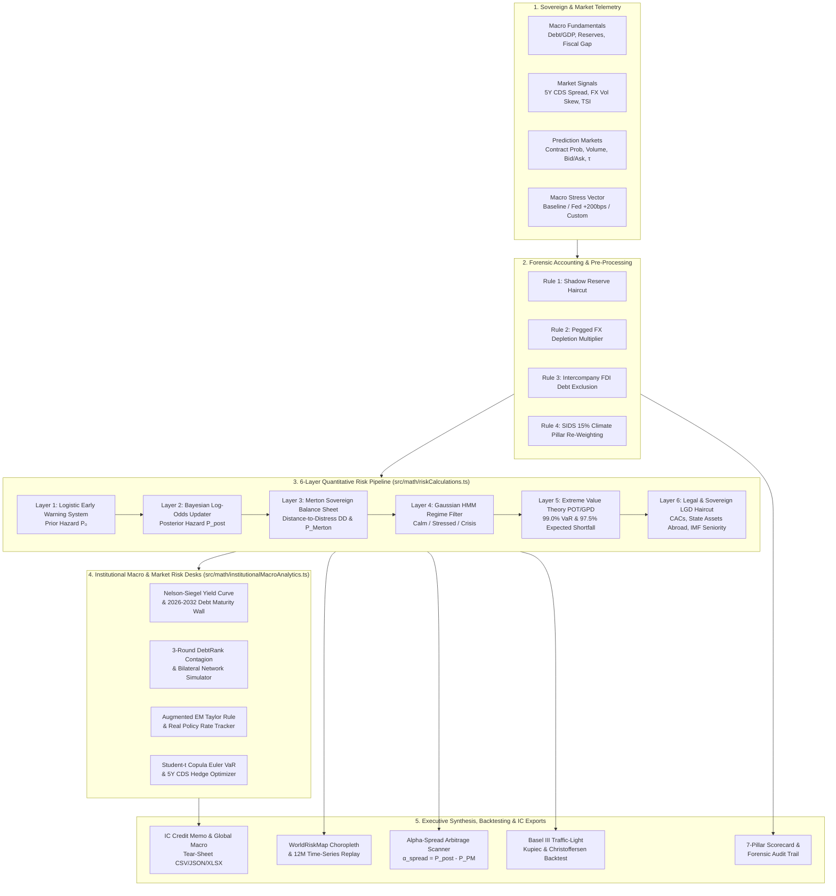

# EconQuest — Sovereign Tail-Risk & Macroeconomic Arbitrage Desk

[](./LICENSE)
[](https://www.typescriptlang.org/)
[](https://react.dev/)
[](https://vitejs.dev/)
[](https://d3js.org/)
[](https://tailwindcss.com/)

**EconQuest** is a local/private research and observed-data monitoring dashboard. The default workspace shows fitted annual
hazard/HMM diagnostics, historical evaluation, durable file ingestion, observed market history and data health.
The older multi-layer risk desks remain available only through **Open experimental sandbox**; their illustrative prices,
scenario adjustments, portfolio risk and trading labels are not observed monitoring or validated investment outputs.

> **Implementation status**: Layer 1 now uses genuinely fitted Firth regression and LightGBM; the runtime Layer 3 uses a fitted three-state annual Gaussian HMM. Browser inference needs no API key or Python server. The bundled model is **research-only**, uses observations through **2024** (a next-year hazard refers to **2025**, not today), and does **not** outperform a constant-rate baseline on held-out Brier score/log loss. Other risk layers, market inputs, and generated replay charts remain illustrative. See [Fitted annual models](#fitted-annual-models-training-data-and-limitations) for the authoritative implementation, data definitions, and reproduction commands; the older white-paper specifications below are not evidence of empirical validation.

> **Operational scope:** a manual Yahoo Finance/yfinance adapter supplies five years of completed daily
> **EMB, PCY, ECH and TUR** ETF share prices. No API key is required. Use **Provider pulls** to acknowledge
> personal research use, pull, review the validation report, then explicitly commit. No scheduled pulls or
> streaming quotes are enabled. Endpoints in [the catalog](./src/data/defaultDataFeeds.ts) do not imply connectivity.
> [The Python backend](./backend/) supplies provider acquisition, persistence and validated CSV/XLSX ingestion.
> The historical baseline remains viewable without the backend, but is explicitly not an active/live dataset.

### Research workflow and boundaries

1. Start the backend and frontend as described in [Quickstart](#4-quickstart--local-development).
2. Open **Provider pulls** for provider acquisition, **Monthly IMF** for monthly IMF data,
   **WEO research** for the annual IMF outlook, **World Bank research** for WDI history,
   **IDS research** for World Bank external-debt history,
   **FRED / ALFRED** for global conditions and historical as-of snapshots,
   **BIS research** for quarterly banking/credit history, **UN Comtrade** for resumable annual merchandise trade,
   **GDELT research** for global daily machine-coded news-event records,
   **ACLED research** for account-accessible conflict/protest events, or
   **File ingestion** to upload CSV/XLSX with explicit source/units.
3. Inspect the staged rows and errors, then explicitly **Commit staged version**. Invalid batches are quarantined.
4. Inspect **Observed monitoring**, **Annual research** and **Data health**. Last valid data remains visible after failures;
   unknown or expired freshness blocks current signals. No trading signals are generated.
5. Use **Activate this version** to restore a previous dataset without deleting its history. Download a database backup regularly.

Imports replace the entire active dataset of their kind, not individual rows of earlier imports.
Annual inference explicitly overlays that active dataset onto bundled history: matching country-years replace bundled rows,
consecutive years append, omitted countries/years retain their disclosed baseline. It does not retrain models or mutate
the training panel, fitted artifact or historical evaluation. All market observations are isolated from annual inference.

Source, exact units, original file hash, ingestion/run identity and revision history are retained.
Unknown publication dates remain unknown. A user-entered maximum observation age is an explicit policy,
not a verified provider release/trading-calendar policy; absent policy is **unverified**.
Observation age is distinct from import/retrieval age.

### ACLED conflict and protest research

**ACLED research** uses the unofficial [`acled==1.0.2`](https://pypi.org/project/acled/)
wrapper for the core **dyadic events** endpoint: a global request covering the latest
**30 completed UTC event-date days**, all core event types. It excludes CAST forecasts,
monadic actor duplication and automatic GDELT merges. Each pull is a new, immutable full
snapshot, not an incremental update to earlier snapshots. Reporting lag means recent days
may be sparse or empty; revised and deleted events can change later snapshots.

An approved **myACLED account with API/data access** is required. Authentication uses
OAuth with email/password, **not legacy API keys**. Configure credentials only in the
backend process environment (`ACLED_USERNAME`, `ACLED_PASSWORD`) or use the VS Code task
**EconQuest: backend with hidden FRED, Comtrade and ACLED prompts**:

```sh
.backend-venv/bin/python -m backend serve --port 8768 --prompt-fred-key --prompt-comtrade-key --prompt-acled
```

Email and password are both hidden at terminal entry. Never paste credentials into chat,
browser fields, URLs, files or command arguments. OAuth tokens remain in memory for one
acquisition; token/refresh-token responses are not saved, exported or logged. No cookie or
legacy-key fallback is enabled. Restarting an existing backend requires re-entering its
other private keys. Old running backends explicitly block ACLED pulls until restart.

After acknowledging account terms/source limitations, manually pull, inspect native records
and pagination reports, then explicitly activate the separate ACLED snapshot if desired.
All pages must match provider totals, and two complete reads must agree on native event
IDs and attributes. Missing pages, duplicate IDs, revisions between reads, quota/auth errors,
empty results or exceeded budgets leave an explicit **interrupted, inactive** snapshot;
earlier valid data remains unchanged. Original event-response bytes and SHA-256 hashes are
retained; authentication bodies are not. Download originals or a **private** NDJSON export.
No scheduler, automatic resume, alert generation or fitted-model changes are enabled.

**Global is the requested scope, not proof of unrestricted access or exhaustive events.**
Results are restricted to the account's entitlements and ACLED's source coverage. Time and
geography precision codes remain visible; dates/coordinates may be approximate. Fatalities
are reported estimates, including uncertain zeros, not audited death counts. Native source
timestamps indicate database updates, not article publication or historical availability.
Country names and native numeric codes are retained without inferred ISO/GDELT mappings.
ACLED and GDELT remain independent research views; no independence/corroboration is assumed.

Source: **ACLED**. Use is subject to the account's license, [ACLED terms, EULA, content
usage and attribution policy](https://acleddata.com/terms-and-conditions); private exports
are not permission to publicly redistribute data. The wrapper is **GPL-3.0 licensed**;
review redistribution obligations before distributing the application. See the
[bounded backend contract](./backend/README.md#acled-core-events-contract).

### GDELT global daily events

**GDELT research** uses pinned server-side [`gdelt==0.1.14`](https://pypi.org/project/gdelt/)
(gdeltPyR), with **no API key**. An explicit, consented pull freezes the latest completed
UTC day and retrieves all **96 quarter-hour GDELT 2.0 Events export archives** globally.
It does not use the package's default single-interval coverage, keyword headline search,
Mentions, GKG or article-text retrieval. There is no scheduler or automatic resume.

Original compressed ZIP bytes, SHA-256 hashes, retrieval timestamps and HTTP status are
immutable. All **61 native fields** are preserved as strings, including leading-zero CAMEO
event codes; normalized numeric fields remain descriptive, not probabilities.
Review event dates separately from database ingestion (`DATEADDED`): events can predate the
export day. Article publication time is unknown. Country filters use **native action-location
GDELT geography codes, not ISO2** (RS means Russia, UP means Ukraine); actor country codes
are a separate CAMEO system. Unknown locations are retained without guessed mappings.

Missing/failed intervals, malformed archives, duplicate event IDs or exceeded budgets leave
an explicit **interrupted, inactive** snapshot with captured diagnostics. Only a nonempty
day with all 96 verified intervals can stage for manual activation. Inspect records, interval
coverage and native attributes; download originals or NDJSON, then explicitly activate or
roll back the separate research snapshot. No GDELT observations enter annual fitted models,
alerts or sovereign risk scores. A new manual pull requests the latest completed day again.
An older running backend shows an explicit restart-required message instead of starting a pull.

GDELT records are machine-coded media observations, **not verified incidents** or unique
real-world event counts. Media/language bias, repeated stories and extraction errors apply.
All requested archives being present does not establish exhaustive real-world coverage.
Source article links are references only; article full text is neither acquired nor redistributed.
The requested package is **GPL-3.0 licensed**: this integration targets private/local research;
review license obligations before distributing the combined application. The application MIT
badge does not relicense dependencies. See [the backend contract](./backend/README.md#gdelt-daily-events-contract).

### UN Comtrade annual merchandise trade

**UN Comtrade** uses pinned server-side `comtradeapicall` for annual goods (`C/A`),
imports/exports (`M/X`), TOTAL products and all source partners, from 1962 through the
last completed calendar year. Discovery freezes the reporter catalog and available
original-classification reporter/year datasets, retaining historical reporting identities.
HS uses the `HS` search route with the returned original revision validated; earlier
SITC history uses its original classification. Converted duplicates, mirror substitution
and estimate-complemented Trade Matrix are not used.

Configure the key **only in the backend**, using the VS Code task
**EconQuest: backend with hidden FRED and Comtrade key prompts**, or:

```sh
.backend-venv/bin/python -m backend serve --port 8768 --prompt-fred-key --prompt-comtrade-key
```

Do not paste keys into chat, browser fields, URLs or configuration files. Stop an existing
backend only with approval before starting its replacement; refresh the browser afterward.
The capability check blocks acquisition on an old backend or without a configured key.

Confirm the scope, then **Start new Comtrade acquisition**. Each explicit pass stops
after at most 40 requests, approximately five minutes (an in-flight socket operation can
take its bounded timeout), or 128 MiB, whichever comes first. The durable local ledger
reserves requests before network access, at most **450 in a rolling 24 hours**, leaving
50 of the Basic plan's 500 calls/day as headroom. Other users of the same key can exhaust
its quota sooner. A provider 429 stops the pass and imposes a conservative 24-hour pause;
there are no retries, scheduled acquisition or automatic resumes.

Choose **Resume Comtrade pass** to continue the **same acquisition**, including after a
backend restart. Completed chunks are immutable and not downloaded again. Incomplete
chunks are retried only on explicit resume; diagnostic originals remain. Global history
can require many passes and multiple quota windows. Only after all availability tasks
and all planned data chunks have been verified does it become **staged**, inactive.
**Activate Comtrade snapshot** and rollback affect only this research provider, not fitted models.

Review per-reporter/partner/flow history and task results, with original responses,
SHA-256 hashes, retrieval times and complete NDJSON export. Values stay in native current
USD. As explicitly selected, official `isReported=false` values are retained with prominent
flags, **not asserted to be directly reported**; that flag alone does not distinguish a
calculated aggregate from an estimate. Quantity-estimation flags do not establish value
estimation. Null/omitted observations are unknown, never zero-filled. World totals,
groups, known special categories and unreviewed partner identities are separate from
individual reporting areas and must not be summed together. No trade-balance,
concentration, contagion or model inference is generated.

This is **not a simultaneous global vintage**: each pending data chunk checks its source
metadata before and after acquisition. Newer revisions since discovery are disclosed in
the task result; changes during a chunk block its completion. Changed original dataset
definitions require a new acquisition. Completed chunks retain their captured releases.
See [the backend contract](./backend/README.md#un-comtrade-contract).

### World Bank International Debt Statistics (IDS)

Open **IDS research**, confirm research use, then **Pull World Bank IDS history**.
This uses the existing server-side `wbgapi` package, **source 6**, without a new package
or API key. It is a separate adapter, review and active selection from WDI (**source 2**).
Acquisition stages an inactive snapshot; review coverage, definitions and originals before
explicitly choosing **Activate IDS snapshot**. Fitted models and other provider selections
remain unchanged.

The reviewed basket has **18 indicators**, all individual economies in source-6 metadata,
all available nonfuture annual rows and a fixed **World (`WLD`) creditor counterpart**:

| Codes | Native definition |
|---|---|
| `DT.DOD.DECT.CD`, `DT.DOD.DLXF.CD`, `DT.DOD.DSTC.CD` | Total, long-term and short-term external debt stocks |
| `DT.DOD.DPPG.CD`, `DT.DOD.DPNG.CD` | Long-term public/publicly guaranteed and private nonguaranteed external stocks |
| `DT.DOD.DIMF.CD` | IMF credit **and SDR allocations**, per the source-6 series title/definition |
| `DT.DOD.MLAT.CD`, `DT.DOD.BLAT.CD`, `DT.DOD.PRVT.CD` | PPG multilateral, bilateral and private-creditor stocks |
| `DT.TDS.DECT.CD`, `DT.INT.DECT.CD` | Total external debt-service and interest payments |
| `DT.AMT.DLXF.CD`, `DT.DIS.DLXF.CD` | Long-term principal repayments and disbursements |
| `DT.NFL.DECT.CD`, `DT.NTR.DECT.CD` | Total external-debt net flows and net transfers |
| `DT.DOD.DECT.GN.ZS`, `DT.TDS.DECT.EX.ZS`, `DT.DOD.DSTC.ZS` | Total stocks/GNI, debt service/exports and short-term/total external debt |

Monetary codes retain current US dollars; ratios retain their provider-specific percentage
denominators. Negative flows are not clipped. No rescaling, filling, derived ratios or
component summation occurs. PPG includes guaranteed obligations, not just sovereign debt;
its creditor groups are not a decomposition of all external debt. Short-term debt is
original maturity of one year or less. Long-term principal/disbursements cannot be treated
as matching components of broader total debt service/interest.

**Important limitations:** the advanced source API does not consistently supply WDI-style
status, units, precision and footnotes. Absence remains unknown; any supplied attributes
are retained and disconnect chart lines. All rows are `reported_unverified`, **not verified
actuals**. Dates at or before the current UTC year can still contain estimates/projections;
the adapter does not infer actual status from dates or source-update time. Future-dated
numeric and null cells are excluded from the normalized history, counted in the report,
and retained in immutable originals. Missing history is disclosed, never filled.

`DT.DOD.DECT.CD`, `DT.DOD.DECT.GN.ZS` and `DT.TDS.DECT.EX.ZS` overlap the WDI basket:
these are **shared-source evidence, not independent corroboration**. Different retrievals
may contain different revisions. IDS does not change the bundled training data or create
point-in-time backtest evidence. See [the backend contract](./backend/README.md#world-bank-ids-contract).

### BIS quarterly banking and credit

Use **BIS research** (also under **Provider pulls**) for manual public SDMX acquisition;
no key or new package is needed. `bis-fetcher` is a speech-PDF/text extraction library,
not a numerical statistics client, and is deliberately not installed.

| Indicator | Source / fixed definition | Native values |
|---|---|---|
| Cross-border banking claims | `WS_LBS_D_PUB` v1.0; stocks, all reporting banking locations, counterparty sectors, instruments and currencies | Millions of USD |
| Cross-border banking liabilities | Same LBS scope, liability side | Millions of USD |
| General-government credit | `WS_TC` v2.0; all lenders, nominal value, adjusted for breaks | % of GDP |
| Private non-financial credit | All lenders, market value, adjusted for breaks | % of GDP |
| Household/NPISH credit | All lenders, market value, adjusted for breaks | % of GDP |
| Non-financial corporation credit | All lenders, market value, adjusted for breaks | % of GDP |

All current ISO individual economies/territories present in either flow's metadata are
included in the coverage catalog. Each query uses that flow's own economy membership;
aggregates, unallocated and historical/non-ISO areas are excluded and listed in the report.
Missing economy/indicator pairs are disclosed, never filled. Full available quarterly
history is requested without a start-date cutoff. Leading/trailing completeness is not
inferred from interior-gap checks; no release-calendar freshness policy is claimed.

LBS is residence-based, **not consolidated banking, a bilateral exposure matrix or
sovereign-only claims**. A liability to a counterparty economy is the reporting banks'
liability, not that economy's sovereign debt. Stocks are not adjusted flows: changes
can include exchange-rate movements and reporting breaks. Credit sector totals overlap:
do not add private non-financial totals to households and corporations. Percentage-of-GDP
credit is not a debt-service ratio or the WDI external-debt definition.

The adapter checks metadata identities, versions, dimension order/code definitions,
public/free classification, units and scaling. It retains dataset/group/series/observation
attributes, exact numeric strings, pre-break values and SHA-256 source lineage. It does
not reapply `UNIT_MULT`: LBS API values are already expressed in millions of USD.
Charts disconnect missing quarters/nulls, flagged observations and unit changes;
full-window/derived analysis is blocked when history is missing or flagged.

Manual pull → review → explicit **Activate BIS snapshot**, with independent rollback.
Every snapshot and original response persists in SQLite/backups. Failures preserve the
last active selection. Fitted models and all other provider selections are unchanged.
These are current revised snapshots, **not historical publication vintages** or
point-in-time backtest evidence. There is no scheduler or automatic retry/fallback.

### First provider: Yahoo ETF history

The [backend adapter](./backend/yahoo.py) sets `auto_adjust=False`, `back_adjust=False`, `repair=False`
and `actions=True` explicitly. The observed value is Yahoo **Close**, not `Adj Close` or a total return.
Yahoo may already adjust/restate historical prices for splits; "no yfinance adjustment" does not mean an
immutable, never-adjusted exchange tape. EMB/PCY are emerging-market bond ETFs, ECH is Chile equity and
TUR is Turkey equity. None is a sovereign yield or CDS quote, and they never modify fitted annual inputs.

Each manual batch verifies all four fund identities, USD currency, ETF type, exchange, New York timezone,
daily frequency, positive finite OHLC/adjusted-close values, consistent OHLC envelopes, volume and corporate
actions, ordered unique rows and **complete expected trading-session coverage**. US ETF sessions use the XNYS
calendar common to these listings, including holidays, DST and early closes. A session is eligible only
30 minutes after its close. Missing/invalid histories quarantine the entire batch; there is no fill,
repair, generated fallback or partial activation.

Source daily bar labels are local midnight; monitoring timestamps are the actual exchange session close
in UTC. Publication times remain unknown. Freshness requires every ETF to contain the latest eligible
session. Browser eligibility expires at the next eligible close until a backend refresh rechecks the calendar.
The durable original is a **captured yfinance library-response JSON snapshot**, not raw HTTP; it retains
OHLCV, `Adj Close`, dividends, split ratios, capital gains when supplied, selected identity metadata and query
settings. Review/download the original via **Review stored run** in Data health; snapshots have SHA-256
lineage. Provider jobs, reports and originals survive restarts and are included in database backups.

One pull runs at a time, with a 90-second whole-operation timeout and 60-second cooldown. No retries or
automatic polling are hidden. Yahoo/yfinance is unofficial and can fail, rate-limit or revise history.
Use only for local personal research under [Yahoo/yfinance's usage limitations](https://ranaroussi.github.io/yfinance/);
no redistribution. Validation detects contract problems, not all plausible bad prices, and is **not independent
vendor price verification**. The existing sandbox benchmark quotes remain fixtures.

### Monthly IMF

Open **Monthly IMF** (also shown under **Provider pulls**) and acknowledge authorized
research use. Each manual acquisition captures 120 **completed calendar months** from
`https://api.imf.org/external/sdmx/2.1`. The supplied `sdmx.Client('IMF_DATA')` route works,
but `CP01` means **food and non-alcoholic beverages**: this connector uses **`_T` (All Items)**.
It parses SDMX directly with validated metadata and inherited attributes; `sdmx1` is not required.
The discontinued single IFS dataset is not queried using guessed legacy series codes.

| Topic | Frozen flow version | Monthly series |
|---|---|---|
| CPI | 5.0.0 | `CPI._T.IX.M`, `CPI._T.YOY_PCH_PA_PT.M` |
| Exchange rates | ER 4.0.1 | `XDC_USD.PA_RT.M` (domestic currency per USD, period average) |
| International liquidity | IL 13.0.1 | `TRGMV_REVS.USD.M` (total reserves, gold at market value) |
| Interest rates | MFS_IR 9.0.0 | `MFS166_RT_PT_A_PT.M` (monetary policy-related rate, percent per annum) |

The universe is the maintained `pycountry` current-country/territory list matched to IMF metadata,
plus explicitly reviewed IMF **KOS** (Kosovo, no ISO3 asserted) and **WBG** (West Bank and Gaza;
ISO PSE association, source code retained). Aggregates, unions, combined and historical areas
are listed with reasons in the run report. Unreviewed areas block activation.
No unavailable monthly series is replaced with annual data, another indicator or another vendor.

**Available monthly coverage (v2):** all matched economies and all five indicators remain in
the coverage matrix, including entirely absent pairs. Missing pairs/internal months are
disclosed, never filled or replaced with annual data. They do not quarantine otherwise
validated monthly history; affected histories and derived changes remain unavailable.
Forecasts/non-IFS observations do not count; provisional/estimated flags remain visible.
Numeric observations with statuses absent from captured metadata (including the source's
undocumented `T` status) are excluded individually, with exact raw value/status, exclusion
reason and originals retained. The status is not guessed or relabeled normal. All other
valid rows in the response remain available.

Changed dimensions/definitions, invalid values, restricted data, incomplete transport and
an all-unusable basket still block activation. Explicit activation checks actual row,
numeric and coverage counts. Existing **v1 strict snapshots keep their original policy**:
they are not silently unquarantined. Reprocessing creates a new v2 revision with original
source retrieval time and lineage, not a fresh acquisition or point-in-time vintage claim.
Invalid/failed acquisition never replaces an active revision.

Run reports, paginated coverage/series, response checksums, exact original responses, source flags,
reference bases and NDJSON exports survive restart and database backup. A later retrieved vintage
is compared against the prior active/completed basket with overlap, changed/added/removed counts
and bounded change samples. This is **not** point-in-time historical publication evidence.

**Native scaling caveat:** exact API `OBS_VALUE` text and numeric values are retained, alongside
`SCALE`; the latter is **not blindly applied as a multiplier**. Reserve probes already return
plausible full-dollar values despite `SCALE=6`. Conversion semantics are not independently
verified, so standardized monetary comparisons remain blocked. CPI bases differ across economies;
published monetary-policy-related rates have national definitions, not harmonized policy targets.
Charts disconnect gaps/base/definition breaks. Adjacent native changes require consecutive comparable
observations and verified unit scale; reserve changes are blocked. Freshness is **unknown** without
a verified release-lag policy. Dataset publication timestamps are not observation release times.

IMF macro revisions have their **own** explicit commit/activation/rollback selection, separate from
ETF history and annual fitted Firth/LightGBM/HMM inputs. There is no retraining, automatic activation
or scheduled acquisition. Job-status polling only watches a user-triggered run. The selected public
routes were verified without a key; 401/403/429/timeouts remain explicit failures, not alternative-provider
fallbacks. No unsupported credential/header scheme is guessed.
See [backend limits and API](./backend/README.md#imf-monthly-contract).

### IMF WEO annual research and projections

Open **WEO research**, acknowledge authorized research use, and choose **Pull latest WEO release**.
The connector requests the verified `IMF.RES:WEO` SDMX flow/DSD version **9.0.0**, with dimensions
`COUNTRY.INDICATOR.FREQUENCY` and annual frequency **A**. It captures the metadata and all available
annual years without a rolling-history cutoff. No `sdmx1` package, API key or guessed legacy
WEO subject-code crosswalk is needed. A changed flow/DSD version requires contract review.
The official [WEO dataset page](https://data.imf.org/en/datasets/IMF.RES:WEO) describes the release.

All **145 indicator definitions** in the verified catalog are exposed, including indicators
that are global/commodity-only and therefore have no individual-economy observations.
The maintained current ISO-matched IMF universe plus reviewed KOS/WBG mappings is queried;
aggregates, currency unions, historical and combined areas (including WEO GX123) are excluded
and listed. Requested economies are not falsely counted as economies with data.

**WEO-specific coverage policy:** missing series/years are allowed but disclosed, never zero-filled.
They block the affected analysis rather than quarantine an otherwise valid release.
WEO and Monthly IMF remain independent selections with distinct annual/monthly contracts.
Contract failures, mixed release publication/update timestamps, non-public classifications,
unknown numeric statuses, duplicate keys or non-finite values stop the WEO job without activation.
Each response is durably retained; parsed annual history and series metadata are staged atomically.

Classification uses each series' **`LATEST_ACTUAL_ANNUAL_DATA`**, inherited from IMF group
metadata. Years through a verified calendar-year cutoff are labeled **actual per IMF boundary,
revisable**; later years are **IMF estimate/projection**, including estimates for past years.
No unsupported split between IMF estimates and forecasts is invented. Missing, non-calendar
or unmapped boundaries, including `FY2024/25` and `Not applicable`, remain **unknown** rather
than being guessed from the current year. The original cutoff, methodology, fiscal-year reporting
conventions and projection basis are inspectable. Unknown-boundary rows are not fed into models.

Charts separate actual (cyan), estimate/projection (dashed amber) and unknown (gray), and never
join missing years or classification/status breaks. Series with unavailable units/scales or
unmapped actual-data boundaries are explicitly blocked for comparative/derived analysis.
Native numeric/text `OBS_VALUE` is retained **without multiplying `SCALE`**; source unit and
scale labels remain separate metadata. Cross-country monetary levels, rebasing conversions,
forecast evaluation and current release freshness are not asserted.

Use **Commit WEO release** only after reviewing the release, gaps, flags and raw-source manifest.
WEO has its own active selection, snapshot history, explicit activation/rollback and streaming
NDJSON export. It never replaces Yahoo or monthly IMF data and never changes fitted
Firth/LightGBM/HMM inputs or training/backtest artifacts. The release publication timestamp is
not per-observation historical availability; repeated retrieved snapshots are not a historical
vintage archive. Manual pulls only, no scheduler/retries/automatic activation.

Real onboarding evidence: the release published **2026-10-13** yielded **337,514 annual records**,
**7,672 series**, **197 economies with values**, **44 populated individual-economy indicators**
and years **1980–2031**, from 14 captured responses. All 145 catalog definitions and 249 requested
economies remain visible; **28,436 of 36,105** catalog economy/indicator pairs have no valid values.
**67,819 numeric rows** have unknown actual/projection classification, and 2,042 source series
have missing/unmapped analytical metadata. The saved acceptance snapshot remains **staged,
not activated**. These counts describe one retrieved release, not guaranteed future coverage.
See [the WEO backend API](./backend/README.md#weo-annual-contract).

### World Bank WDI research via wbgapi

The backend uses `import wbgapi as wb` (`wbgapi==1.0.14`) against the public
[World Bank Indicators API](https://api.worldbank.org/v2/). No API key or browser-side
Python package is needed. Open **World Bank research**, confirm research use, then
**Pull World Bank WDI history**. The pull is manual and stages an inactive snapshot.
Review the definitions, missing coverage, flags, footnotes and captured originals
before explicitly choosing **Activate World Bank snapshot**.

The approved source **2**, World Development Indicators, basket is fixed:

| Group | Indicator codes |
|---|---|
| Existing six predictors, monitoring only | `DT.DOD.DECT.GN.ZS`, `DT.DOD.DSTC.IR.ZS`, `FI.RES.TOTL.MO`, `NY.GDP.MKTP.KD.ZG`, `FP.CPI.TOTL.ZG`, `BN.CAB.XOKA.GD.ZS` |
| Economic size | `NY.GDP.MKTP.CD`, `NY.GDP.PCAP.CD` |
| External debt/service | `DT.DOD.DECT.CD`, `DT.TDS.DECT.EX.ZS` |
| Buffers/FX | `FI.RES.TOTL.CD`, `PA.NUS.FCRF` |
| Trade/capital | `NE.EXP.GNFS.ZS`, `NE.IMP.GNFS.ZS`, `BX.KLT.DINV.WD.GD.ZS` |
| Central-government fiscal | `GC.DOD.TOTL.GD.ZS`, `GC.REV.XGRT.GD.ZS` |

`GC.BAL.CASH.GD.ZS` is excluded: it was not in the verified current WDI catalog.
The complete source definitions and source organizations remain inspectable.
Economies are the intersection of WDI source-specific membership and the country
catalog's **non-aggregate** classification, not an IMF or guessed ISO universe.
All available annual periods are requested, with no rolling-history cutoff.

Missing series/years are allowed but reported for **every** requested pair, including
entirely absent series. Nulls are never zero-filled or replaced by another provider.
Native API numbers, unit fields (often blank), decimal precision, `obs_status`,
footnotes and source-page hashes are retained. Indicator definitions describe the
native convention; no numeric scaling, currency conversion or harmonization is applied.
Charts disconnect gaps, flags, footnotes and unit changes. Full-window/derived analysis
is blocked for series with gaps or flags; no derived analytics or cross-source comparisons
are implemented here. Blank status does **not** establish actual/forecast classification.

WDI `lastupdated` describes the **source revision**, not an observation's publication
date or historical point-in-time availability. Repeated retrieved snapshots are not
a reconstructed historical vintage archive. Central-government fiscal debt/revenue
must not be silently compared to WEO general-government series. WDI supplies no sovereign
default labels. This path never changes the fitted-model input overlay, training data,
HMM/Firth/LightGBM artifacts, or Yahoo/IMF/WEO selections.

The verified source revision **2026-10-08** supplied **243,474 annual records including
explicit nulls**, covering **1960–2025**, all **17 indicators**, and **217 requested
individual economies**. **215** economies have numeric values; **741 of 3,689** requested
pairs have no numeric observations. Original responses and staged snapshots are retained;
none is automatically activated. These are onboarding counts, not promised coverage.
See [the World Bank backend contract](./backend/README.md#world-bank-wdi-contract).

### FRED and ALFRED: native history and historical snapshots

Open **FRED / ALFRED** for the reviewed 18-series basket:

| Group | Series |
|---|---|
| Treasury curve | `DGS1`, `DGS2`, `DGS3`, `DGS5`, `DGS7`, `DGS10`, `DGS20`, `DGS30` |
| Funding/policy | `SOFR`, `EFFR` |
| Dollar/market stress | `DTWEXBGS`, `VIXCLS` |
| Commodities | `DCOILBRENTEU`, `PCOPPUSDM`, `PWHEAMTUSDM` |
| Revision-sensitive US macro | `GDP`, `CPIAUCSL`, `UNRATE` |

**Definitions matter:** `GDP` is nominal GDP, not real GDP. `DTWEXBGS` is the broad
trade-weighted dollar index, not ICE DXY. FRED source titles, notes, units, seasonal
adjustment and native frequency are retained. No resampling, transformations, seasonal
adjustment changes, forward fills or currency conversions are applied. Source-specific
data licensing still applies; API access is not permission to redistribute every series.

FRED/ALFRED use the [same official API](https://fred.stlouisfed.org/docs/api/fred/)
and require your own [registered FRED key](https://fredaccount.stlouisfed.org/apikeys).
Set `FRED_API_KEY` in the **Python backend process environment** and restart that
process. The backend does not automatically load an `.env` file. Never use `VITE_*`,
paste the key into chat, or put it in tracked files.

For a temporary session in the default macOS **zsh** terminal, run from this workspace:

```zsh
.backend-venv/bin/python -m backend serve --port 8768 --prompt-fred-key
```

This prompts without echoing the key or putting it in shell history, rejects unsafe
noninteractive/echo-fallback input, and stores it only in the backend process environment.
Alternatively, run **Terminal → Run Task → EconQuest: backend with hidden FRED key prompt**
in VS Code. Keep that terminal open.
Stop an earlier backend before opening the same database; only one process may own it.
The configuration indicator reports only whether a key of the expected shape exists,
**not** whether the API has accepted it.

Choose **Current FRED history** for the latest available history, pinned to the pull's
US Central calendar date. Choose **Historical ALFRED as-of snapshot** and an explicit
date for values reported as available then. All available observation history through
that date is requested at native frequency. No full revision archive is downloaded.
Vintage-date lists document archive availability; where no archived vintage is available
on/before the requested date, the series is explicitly unavailable, never replaced with
current data. A snapshot with no numeric values cannot activate.

Each pull is saved **staged/inactive**, with native text/numbers, explicit missing `"."`
values, series metadata, captured original responses and hashes. Review gaps and vintage
coverage before activation. Current and historical snapshots have **separate** active
selections and rollback histories; activating an old vintage cannot become the current
FRED selection or affect any fitted-model/other-provider input. Existing explicit file
import behavior is unchanged.

Real-time bounds are date-level, **query-clipped** metadata, not original per-observation
release timestamps. Period labels are not publication dates. ALFRED's archive coverage
is limited; absence of an earlier vintage does not establish that no data existed then.
Charts disconnect missing and nonconsecutive native periods (including daily weekends/
holidays), without inventing calendars. No freshness policy, derived spreads, revised-vintage
backtest, calibrated forecasts or trading signals are inferred from these pulls.

HTTP errors, API errors, metadata changes during a current pull, truncation, duplicates,
invalid dates and budget exhaustion fail explicitly without changing prior selections.
Keys are transmitted only to the fixed official HTTPS endpoint, excluded from stored URLs,
and never returned to the browser. Responses that echo the credential are not persisted.
See [the backend contract](./backend/README.md#fredalfred-contract).

Real manual-API onboarding: the **2026-10-20 current** snapshot contains **163,319 rows**,
**153,953 numeric values** and **9,366 explicit missing dots**, with all **18 series**
populated across **81 captured responses**. The **2010-01-01 ALFRED** snapshot contains
**83,978 rows**, **79,453 numeric values**, **4,525 missing dots**, and **11 populated
series** across **63 responses**. The historical snapshot has no eligible captured
vintage for SOFR, EFFR, DTWEXBGS, VIXCLS or the three commodity series; these are explicitly
unavailable, not backfilled from current data. Both snapshots remain **staged/inactive**.
These are retrieved-archive coverage facts, not guaranteed future availability.

Required CSV headers (XLSX uses the same column names):

```text
# Annual, units fixed to model-feature-units; at least two consecutive completed years per included country
country_code,year,in_default,externalDebtGni,shortTermDebtReserves,reservesMonths,gdpGrowth,inflation,currentAccountGdp,published_at

# Market, one explicit unit/convention per dataset
symbol,observed_at,value,published_at
```

`published_at` is optional; use UTC ISO timestamps when known. Files must be UTF-8 CSV or values-only XLSX;
legacy XLS/macros are not supported. Limits: 5 MiB upload, 10,000 rows, 20 sheets, bounded XLSX expansion.
There is no guessed country mapping, currency conversion, split adjustment, futures rolling or automatic provider polling.
Market changes are absolute changes between supplied observations, not total returns.
Source timestamps are assertions from the supplied file, not independently authenticated historical availability.

Research JSON exports carry inputs, baseline hash, dataset/model versions and limitations. Experimental exports are
marked as sandbox output and cannot be produced by the research workspace.

**The specification sections below describe the legacy experimental desks unless explicitly stated otherwise.**

---

## Table of Contents

1. [Executive Overview & Core Capabilities](#1-executive-overview--core-capabilities)
2. [System Architecture](#2-system-architecture)
3. [Quantitative Methodology & Mathematical Formulation](#3-quantitative-methodology--mathematical-formulation)
   - [6-Layer Quantitative Risk Pipeline](#31-the-6-layer-quantitative-risk-pipeline)
   - [7-Pillar Macroeconomic Vulnerability Scorecard](#32-the-7-pillar-macroeconomic-vulnerability-scorecard)
   - [Cross-Market Arbitrage Alpha ($\alpha_{\text{spread}}$)](#33-cross-market-arbitrage-alpha-alpha_textspread)
   - [Basel III Traffic-Light Backtesting](#34-basel-iii-traffic-light-backtesting-kupiec--christoffersen)
   - [Sovereign Yield Curve Term Structure & Debt Maturity Walls](#35-sovereign-yield-curve-term-structure--debt-maturity-walls)
   - [Systemic Contagion Network & 3-Round DebtRank Simulator](#36-systemic-contagion-network--3-round-debtrank-simulator)
   - [Central Bank Policy & Open-Economy Augmented Taylor Rule](#37-central-bank-policy--open-economy-augmented-taylor-rule)
   - [Multi-Sovereign Portfolio VaR & 5Y CDS Hedge Optimizer](#38-multi-sovereign-portfolio-var--5y-cds-hedge-optimizer)
4. [Quickstart & Local Development](#4-quickstart--local-development)
5. [Repository Structure](#5-repository-structure)
6. [Extending the Desk (Adding Sovereigns & Shocks)](#6-extending-the-desk-adding-sovereigns--shocks)
7. [Empirical Case Studies & Benchmark Sovereigns](#7-empirical-case-studies--benchmark-sovereigns)
8. [Institutional Roadmap & Technical Blueprints](#8-institutional-roadmap--technical-blueprints)
9. [Academic Citation, Security & Governance](#9-academic-citation-security--governance)
10. [License & Disclaimer](#10-license--disclaimer)

---

## 1. Executive Overview & Core Capabilities

| Desk Module | Key Quantitative & Visual Features |
| :--- | :--- |
| **🌍 Global Risk Map (`WorldRiskMap`)** | Interactive D3.js Natural Earth projection choropleth with pan/zoom, maritime chokepoint overlays (Malacca, Hormuz, Bab el-Mandeb, Suez, Bosporus, Panama, Cape of Good Hope), 5 discrete traffic-light risk tiers, and a **12-Month Time-Series Replay Scrubber** (`Nov 2025 – Oct 2026`). |
| **📐 6-Layer Risk Engine (`SovereignCockpit`)** | Sequential structural + reduced-form pipeline computing Logistic EWS prior, Bayesian market-updated posterior hazard, Merton structural Distance-to-Distress ($DD$), Gaussian HMM regime state, POT/GPD $\text{VaR}_{99}$ & $\text{ES}_{97.5}$, and Legal/CAC LGD haircut. |
| **🏛️ 7-Pillar Vulnerability Scorecard (`SovereignScorecardView`)** | Granular 0–100 scoring across Fiscal, External, Institutional, Political, Macro, Security, and Climate/SIDS pillars with automated **Forensic Accounting Rules** (Rule 3 Intercompany FDI filtering, Pegged FX depletion penalty, and 15% Small Island Developing State weight reallocation). |
| **📉 Yield Curve & Debt Maturity Wall (`YieldCurveMaturityDesk`)** | Parametric **Nelson-Siegel** yield curve fitting (1Y–30Y USD Eurobonds, Local Currency, and US Treasury benchmark), 2s10s slope inversion detector, 5Y CDS-bond basis arbitrage tracker, Gross Financing Need ($\text{GFN}$), and **2026–2032 Sovereign Debt Maturity Walls** against net FX reserves. |
| **🕸️ Systemic Contagion Network (`ContagionCascadeDesk`)** | Interactive D3.js bilateral spillover network and **3-Round DebtRank Contagion Simulator** propagating sovereign default shocks across Trade, BIS Banking Claims, and Global EM Portfolio channels. |
| **🏦 Central Bank Policy & Taylor Rule (`CentralBankPolicyDesk`)** | Tracks G10/EM policy rates against an open-economy **Augmented Taylor Rule**, quantifying behind-the-curve policy rate gaps, ex-post real interest rates, FX pass-through sensitivity, and REER valuation misalignment. |
| **💼 Portfolio VaR & Hedge Optimizer (`PortfolioVarOptimizerDesk`)** | Multi-sovereign bond book builder with **Student-$t$ Copula ($\nu = 4$) Euler Component VaR** decomposition, diversification benefit calculation, and an automated **5Y CDS Hedge Ratio Optimizer**. |
| **⚡ Prediction Market Arbitrage ($\alpha_{\text{spread}}$)** | Real-time divergence engine comparing calibrated model posterior hazard against live prediction market contract probabilities (Polymarket / Kalshi) adjusted for order-book depth ($\tau$) and bid-ask micro-structure. |
| **📄 IC Tear-Sheet Exporter (`IcTearSheetModal`)** | Interactive **Investment Committee (IC) Credit Memo & Global Macro Pack** generator with 1-click **CSV / JSON / XLSX** quantitative snapshot exports. |
| **📚 White Paper, Roadmap & Architecture Explorer (`WhitePaperViewer`)** | Embedded white paper PDF reader plus interactive browser for the 10-module mathematical specification, 2026–2027 engineering roadmap (`ROADMAP.md`), release history (`CHANGELOG.md`), and academic citation metadata (`CITATION.cff`). |

---

## 2. System Architecture



---

## 3. Quantitative Methodology & Mathematical Formulation

Browser inference resides in [`src/math/`](./src/math/); model fitting and public-data preparation reside in [`quant/`](./quant/).

### 3.1 The 6-Layer Quantitative Risk Pipeline

#### Layer 1: Logistic Early Warning System (EWS Prior)
The implemented annual model fits Jeffreys-penalized Firth logistic regression on six observed WDI predictors, with a real monotonic LightGBM challenger. Each predictor is transformed by `asinh(x / featureScale)` and standardized using training-only statistics. Missing predictors use training-only medians. The target is next-year entry into a positive BoC-BoE total debt-in-default stock, conditional on no current default:

$$z_0 = \widehat{\beta}_0 + \sum_{j=1}^{6}\widehat{\beta}_j\,\mathrm{standardize}\!\left(\mathrm{asinh}(x_j/s_j)\right)$$

$$P_0 = \sigma(z_0) = \frac{1}{1 + e^{-z_0}}$$

The six fitted predictors are external debt/GNI, short-term debt/total reserves, gross reserve import cover, real GDP growth, CPI inflation, and current account/GDP. They are **not** aliases for the legacy demo public-debt, net-reserve, PITF, primary-deficit or commodity-index fields. The WDI short-term-debt series is not claimed to implement the paper's bespoke FDI exclusion rule. Final prior probabilities blend Firth and LightGBM using a temporal-validation-selected weight, not a fixed 60/40 rule.

#### Layer 2: Bayesian Market Signal Log-Odds Updating
Updates the EWS prior log-odds $\ln\left(\frac{P_0}{1 - P_0}\right)$ using high-frequency market log-likelihood ratios ($LLR$) from 5Y Credit Default Swaps (CDS), 25-delta FX risk-reversal volatility skew, NLP Text Stress Index ($\text{TSI}$), and liquidity-weighted prediction market contracts:

$$\ln\left(\frac{P_{\text{post}}}{1 - P_{\text{post}}}\right) = \ln\left(\frac{P_0}{1 - P_0}\right) + w_{\text{CDS}} \cdot LLR_{\text{CDS}} + w_{\text{FX}} \cdot LLR_{\text{FX}} + w_{\text{TSI}} \cdot LLR_{\text{TSI}} + \tau^{*} \cdot LLR_{\text{PM}}$$

where the prediction market confidence weight $\tau^{*} = \frac{\tau}{1 + \tau}$ scales with order-book depth and tight bid-ask spreads.

#### Layer 3: Structural Merton Sovereign Balance Sheet Model
Models sovereign solvency using a contingent-claims structural framework where $V_A$ is effective sovereign fiscal & reserve asset value, $D_B$ is the distress barrier, and $\sigma_A$ is asset volatility:

$$DD = \frac{\ln(V_A / D_B) + \left(\mu - \frac{1}{2}\sigma_A^2\right)T}{\sigma_A \sqrt{T}}, \qquad P_{\text{Merton}} = \Phi(-DD)$$

#### Layer 4: Gaussian Hidden Markov Model (HMM) Regime Switching
In the runtime this is **Layer 3** (severity is Layer 4). A three-state diagonal-Gaussian HMM is fitted by Baum-Welch to annual gross reserves, GDP growth, and inflation, using separate consecutive country sequences. Browser inference uses the learned initial distribution, transition matrix, and emissions with log-space causal forward filtering. State names order learned emissions by macro stress, not hazard thresholds. These are annual macro regimes, not monthly CDS/liquidity regimes or supervised crisis classifications.

#### Layer 5: Extreme Value Theory (POT / Generalized Pareto Distribution) Tail Risk
Models credit spread and sovereign bond loss distributions beyond a high threshold $u$ using the Generalized Pareto Distribution (GPD) with tail shape parameter $\xi > 0$ and scale $\beta$:

$$\text{VaR}_{\alpha} = u + \frac{\beta}{\xi} \left[ \left( \frac{n}{N_u}(1 - \alpha) \right)^{-\xi} - 1 \right]$$

$$\text{ES}_{\alpha} = \frac{\text{VaR}_{\alpha}}{1 - \xi} + \frac{\beta - \xi u}{1 - \xi}$$

Produces both **99.0% Value-at-Risk ($\text{VaR}_{99}$)** and **97.5% Expected Shortfall ($\text{ES}_{97.5}$)** in accordance with Basel III Fundamental Review of the Trading Book (FRTB) guidelines.

#### Layer 6: Legal & Institutional LGD Haircut
Adjusts Loss Given Default ($\text{LGD}$) for creditor holdout litigation risk, presence of enhanced Collective Action Clauses (CACs), attachable commercial state assets abroad ($>\$10\text{B}$ threshold), and IMF catalytic lending seniority.

---

### 3.2 The 7-Pillar Macroeconomic Vulnerability Scorecard

Each sovereign is evaluated across 7 structural pillars $P_1, \dots, P_7 \in [0, 100]$:

| Pillar | Standard Weight | SIDS / Island Weight | Core Indicators |
| :--- | :---: | :---: | :--- |
| **P1: Fiscal & Debt Sustainability** | 20% | 17% | Public Debt/GDP, Primary Balance Gap, Interest-to-Revenue |
| **P2: External & FX Fragility** | 20% | 18% | Filtered ST FX Debt/Reserves, Import Cover Months, FX Regime |
| **P3: Institutional & Legal Integrity** | 15% | 13% | Rule of Law, CAC Coverage, Central Bank Independence |
| **P4: Political Dynamics & Polarization** | 15% | 13% | PITF Regime Fragility, Election Contestation, Reform Mandate |
| **P5: Macroeconomic & Commodity Exposure** | 15% | 12% | Terms-of-Trade Shock Sensitivity, CPI Pass-Through |
| **P6: Security, Conflict & Chokepoints** | 10% | 12% | Armed Conflict Exposure, Maritime Chokepoint Dependency |
| **P7: Climate & Natural Catastrophe** | **5%** | **15%** | Hurricane/Typhoon Tail Risk, Coastal GDP Concentration, Blue Bonds |

---

### 3.3 Cross-Market Arbitrage Alpha ($\alpha_{\text{spread}}$)

The desk continuously computes the **Alpha-Spread** ($\alpha_{\text{spread}}$), defined as the divergence (in percentage points) between the calibrated 6-Layer Posterior Default Hazard and the implied probability of the sovereign's prediction market contract:

$$\alpha_{\text{spread}} = P_{\text{calibrated}} - P_{\text{PM}}$$

- **$\alpha_{\text{spread}} > +2.5\%$ (Underpriced Sovereign Risk — `BUY PROTECTION / YES`)**: Fundamental and credit-market stress exceeds prediction market pricing. Actionable signal to buy credit protection or accumulate "Yes" restructuring shares.
- **$\alpha_{\text{spread}} < -2.5\%$ (Overpriced Sovereign Panic — `SELL PROTECTION / NO`)**: Retail prediction market participants are overpricing headline noise relative to sovereign reserve buffers and forensic balance sheet reality (e.g., FDI debt misinterpretation).
- **$|\alpha_{\text{spread}}| \le 2.5\%$ (`NEUTRAL / FAIR VALUE`)**: Cross-market equilibrium within bid-ask transaction bounds.

---

### 3.4 Basel III Traffic-Light Backtesting (Kupiec & Christoffersen)

The governance screen calculates tests only when an actual historical forecast/loss JSON series is supplied.
No built-in VaR/ES loss archive exists; absent input is shown as **unavailable**, not passed.
1. **Kupiec Proportion of Failures (POF) Likelihood Ratio Test ($LR_{\text{POF}}$)**: Tests whether the empirical exception frequency matches the supplied confidence level:
   $$LR_{\text{POF}} = -2 \ln \left[ \frac{(1 - p)^{T - x} p^x}{\left(1 - \frac{x}{T}\right)^{T - x} \left(\frac{x}{T}\right)^x} \right] \sim \chi^2_1$$
2. **Christoffersen Independence Test ($LR_{\text{ind}}$)**: Tests whether VaR breaches cluster serially during regime transitions.
3. **Joint Conditional Coverage ($LR_{\text{cc}} = LR_{\text{POF}} + LR_{\text{ind}}$)**: Uses a chi-square distribution with two degrees of freedom. This is not a Basel traffic-light classifier.

Decisions are "reject" or "do not reject" the null at 5%, never regulatory pass/fail.
Asymptotic p-values are unreliable with sparse breaches or small samples.
Independence is unavailable unless transitions following both breach and non-breach states are observed;
calendar gaps never create transitions. ES reports the Acerbi-Szekely statistic
`Z2 = 1 - sum(loss / ES * I(loss > VaR)) / (n * (1-confidence))`,
without a p-value or pass/fail: calibration needs a model-specific null distribution.

#### Historical loss import

Upload a JSON array in the governance screen. Each record requires `portfolio`, `modelVersion`, `unit`,
`forecastIssuedAt`, `periodStart`, `periodEnd`, `confidence`, `var`, and `loss`; `es` is optional.
Use UTC ISO timestamps (for example `2024-01-01T00:00:00Z`), positive losses/negative gains,
nonnegative VaR, and positive ES at least as large as VaR. ES and VaR must use identical confidence,
horizon and units. Supply ES for every row or none.
Imports require at least two completed, non-overlapping periods with the same duration, portfolio,
model version, unit and confidence. Forecast issuance must be no later than period start.
Records are sorted; duplicate/overlapping periods and invalid values are rejected visibly.
Gaps are excluded from transition counts. The importer cannot authenticate claimed issuance dates.
Imports remain in browser memory only and do not retrain models or alter the annual holdout.

---

### 3.5 Sovereign Yield Curve Term Structure & Debt Maturity Walls

Implemented in [`src/math/institutionalMacroAnalytics.ts`](./src/math/institutionalMacroAnalytics.ts) and rendered in [`YieldCurveMaturityDesk.tsx`](./src/components/YieldCurveMaturityDesk.tsx):

#### 1. Parametric Nelson-Siegel Term Structure ($1\text{Y}$ to $30\text{Y}$ Tenors)
Models sovereign USD Eurobond yields $y_{\text{USD}}(\tau)$ and Local Currency sovereign yields $y_{\text{LCY}}(\tau)$ at maturity $\tau \in \{1, 2, 3, 5, 7, 10, 20, 30\}$ years as a function of long-run level ($\beta_0$), short-end distress slope ($\beta_1$), medium-term hump/curvature ($\beta_2$), and decay factor $\lambda$:

$$y(\tau) = \beta_0 + \beta_1 \left(\frac{1 - e^{-\lambda \tau}}{\lambda \tau}\right) + \beta_2 \left(\frac{1 - e^{-\lambda \tau}}{\lambda \tau} - e^{-\lambda \tau}\right) + \Delta y_{\text{shock}}(\tau)$$

When a sovereign enters acute distress ($P_{\text{post}} > 20\%$ or $\text{CDS}_{5\text{Y}} > 800\text{ bps}$), front-end credit jump risk drives $\beta_1 > 0$, inverting the **2s10s slope** ($S_{2\text{s}10\text{s}} = y(10) - y(2) < 0$) as investors price near-term restructuring recovery value across all maturities.

#### 2. 5Y CDS-Bond Basis & Gross Financing Need ($\text{GFN}$)
The arbitrage basis between synthetic credit protection and cash Eurobonds is tracked as:

$$\text{Basis}_{5\text{Y}} = \text{CDS}_{5\text{Y}} - \left( y_{\text{USD}}(5) - y_{\text{UST}}(5) \right) \times 100 \quad (\text{in bps})$$

Annual **2026–2032 Debt Maturity Walls** aggregate amortization schedules across four creditor tiers (Eurobonds $D_t^{\text{Euro}}$, IMF/Multilateral $D_t^{\text{Multi}}$, Bilateral Paris/Non-Paris Club $D_t^{\text{Bilat}}$, and Domestic Local Currency $D_t^{\text{Dom}}$). The sovereign **Rollover Coverage Ratio** against net usable liquid FX reserves $R_{\text{net}}$ is:

$$\text{GFN}_t = \text{Primary Deficit}_t + i_{\text{eff},t} \cdot D_{t-1} + D_t^{\text{Euro}} + D_t^{\text{Multi}} + D_t^{\text{Bilat}} + D_t^{\text{Dom}}, \qquad \text{Reserve Cover}_t = \frac{R_{\text{net}}}{D_t^{\text{FX Service}}}$$

---

### 3.6 Systemic Contagion Network & 3-Round DebtRank Simulator

Implemented in [`src/math/institutionalMacroAnalytics.ts`](./src/math/institutionalMacroAnalytics.ts) and rendered in [`ContagionCascadeDesk.tsx`](./src/components/ContagionCascadeDesk.tsx):

#### 1. Multi-Channel Bilateral Transmission Matrix ($\mathbf{W}$)
Constructs a directed weighted adjacency matrix $W_{ij} \in [0, 1]$ measuring how distress in origin sovereign $i$ transmits to counterparty sovereign $j$ across three structural channels:

$$W_{ij} = \omega_{\text{trade}} W_{ij}^{\text{trade}} + \omega_{\text{bank}} W_{ij}^{\text{BIS}} + \omega_{\text{port}} W_{ij}^{\text{EMBI}}$$

where $W_{ij}^{\text{trade}}$ captures bilateral export/supply-chain elasticity, $W_{ij}^{\text{BIS}}$ captures BIS locational cross-border banking claims relative to Tier-1 capital, and $W_{ij}^{\text{EMBI}}$ captures common institutional EM bond fund rebalancing beta.

#### 2. 3-Round DebtRank Distress Propagation
Adapted from Battiston et al. (2012), each sovereign node $i$ has a continuous distress state $h_i(t) \in [0, 1]$ (where $h_i = 1$ denotes sovereign payment moratorium/default) and reserve absorption buffer $b_i \in [0, 1]$. Given an initial shock $\Delta h_s(0)$ at epicenter sovereign $s$, distress propagates over rounds $t = 1, 2, 3$:

$$h_i(t) = \min\left(1, \; h_i(t-1) + \gamma_{\text{regime}} \cdot \lambda_{\text{decay}}^{t-1} \sum_{j \in \mathcal{A}(t-1)} W_{ji} \cdot \Delta h_j(t-1) \cdot (1 - b_i)\right)$$

$$\Delta \text{CDS}_i(t) = \kappa_{\text{CDS}} \cdot \left(h_i(t) - h_i(0)\right) \cdot \text{LGD}_i$$

where $\mathcal{A}(t-1)$ is the set of newly distressed nodes in round $t-1$ (preventing infinite cyclic self-amplification) and $\gamma_{\text{regime}} \in \{1.0, 1.25, 1.55\}$ scales transmission speed under `Calm`, `Stressed`, or `Crisis` HMM states.

---

### 3.7 Central Bank Policy & Open-Economy Augmented Taylor Rule

Implemented in [`src/math/institutionalMacroAnalytics.ts`](./src/math/institutionalMacroAnalytics.ts) and rendered in [`CentralBankPolicyDesk.tsx`](./src/components/CentralBankPolicyDesk.tsx):

#### 1. Exchange-Rate & Pass-Through Augmented Taylor Rule
Standard closed-economy Taylor rules fail in emerging and frontier markets where exchange-rate depreciation rapidly feeds headline CPI and inflates unhedged FX debt service. EconQuest models the prescriptive nominal policy rate $i_t^{\text{Taylor}}$ as:

$$i_t^{\text{Taylor}} = r_i^* + \pi_t + \phi_{\pi} (\pi_t - \pi_i^*) + \phi_y (y_t - y_i^*) + \gamma_{\text{FX}} \cdot \Delta e_t^{\text{REER}}$$

where:
- $r_i^*$: Sovereign equilibrium neutral real interest rate (incorporating sovereign risk premium).
- $\pi_t, \pi_i^*$: Realized headline Y/Y inflation and central bank inflation target ($\phi_{\pi} = 0.5$).
- $y_t - y_i^*$: Real GDP output gap ($\phi_y = 0.5$).
- $\gamma_{\text{FX}} \cdot \Delta e_t^{\text{REER}}$: Open-economy exchange-rate depreciation pass-through premium required to defend external balance and anchor inflation expectations.

#### 2. Policy Rate Gap & Ex-Post Real Interest Rate Cushion
The desk evaluates monetary orthodoxy via the **Policy Rate Gap** ($\Delta i_t$) and **Real Interest Rate** ($r_t^{\text{real}}$):

$$\Delta i_t = i_t^{\text{actual}} - i_t^{\text{Taylor}}, \qquad r_t^{\text{real}} = i_t^{\text{actual}} - \pi_t$$

- **$\Delta i_t < -150\text{ bps}$ (`BEHIND THE CURVE`)**: Monetary policy is structurally too loose relative to inflation and FX depreciation pressure, accelerating reserve burn.
- **$\Delta i_t \ge +50\text{ bps}$ (`AHEAD OF THE CURVE / ORTHODOX`)**: Restrictive real rate buffer actively defending currency stability and disinflation.

---

### 3.8 Multi-Sovereign Portfolio VaR & 5Y CDS Hedge Optimizer

Implemented in [`src/math/institutionalMacroAnalytics.ts`](./src/math/institutionalMacroAnalytics.ts) and rendered in [`PortfolioVarOptimizerDesk.tsx`](./src/components/PortfolioVarOptimizerDesk.tsx):

#### 1. Student-$t$ Copula ($\nu = 4$) Stress Covariance & Tail Dependence
Given a multi-sovereign bond book with notional weights $\mathbf{w} = (w_1, \dots, w_N)^\top$ ($\sum_{i=1}^N w_i = 1$) and individual Layer-5 99% tail loss volatilities $\boldsymbol{\sigma}$, pairwise correlations $\rho_{ij}$ are stressed via a **Student-$t$ Copula with $\nu = 4$ degrees of freedom**, which captures upper-tail co-movement during global liquidity squeezes:

$$\rho_{ij}^{\text{stress}} = \min\left(0.95, \; \rho_{ij}^{\text{base}} + \theta_{\text{stress}} (1 - \rho_{ij}^{\text{base}})\right), \qquad \Sigma_{ij} = \rho_{ij}^{\text{stress}} \cdot \text{VaR}_{99, i} \cdot \text{VaR}_{99, j}$$

$$\text{VaR}_{99}(P) = \kappa_{t(\nu=4)} \sqrt{\mathbf{w}^\top \boldsymbol{\Sigma} \mathbf{w}}, \qquad \text{Diversification Benefit} = \sum_{i=1}^N w_i \text{VaR}_{99,i} - \text{VaR}_{99}(P)$$

#### 2. Euler Homogeneous Risk Allocation (Marginal & Component VaR)
By Euler's homogeneous function theorem, total portfolio $\text{VaR}_{99}(P)$ decomposes exactly into additive sovereign **Component VaR ($\text{CVaR}_i$)** contributions:

$$\text{MVaR}_i = \frac{\partial \text{VaR}_{99}(P)}{\partial w_i} = \frac{(\boldsymbol{\Sigma} \mathbf{w})_i}{\sqrt{\mathbf{w}^\top \boldsymbol{\Sigma} \mathbf{w}}} \cdot \kappa_{t(\nu=4)}, \qquad \text{CVaR}_i = w_i \cdot \text{MVaR}_i, \qquad \sum_{i=1}^N \text{CVaR}_i = \text{VaR}_{99}(P)$$

#### 3. Automated 5Y CDS Protection Hedge Optimizer
Given a target maximum annual carry budget or target hedge ratio $h_i \in [0, 1]$ per position, the optimizer ranks sovereigns by their **Tail-Risk Reduction per Basis Point of CDS Carry Efficiency ($\eta_i$)**:

$$\eta_i = \frac{\text{CVaR}_i / w_i}{\text{CDS}_{5\text{Y}, i} \text{ (bps)}}, \qquad \text{VaR}_{99}^{\text{hedged}}(P) = \text{VaR}_{99}\left(\mathbf{w} \odot (\mathbf{1} - \beta_{\text{basis}} \mathbf{h})\right)$$

where $\beta_{\text{basis}} \in (0, 1]$ accounts for imperfect CDS-to-cash bond basis correlation during restructuring auctions.

---

## 4. Quickstart & Local Development

### Prerequisites
- **Node.js** 22.12+ within Node 22, or Node 24 (Node 22 is verified; `.nvmrc` selects it)
- **npm** `>= 10.x`
- **Python** 3.13 for the local backend and separately reproduced model training

### Installation & Running Locally

```bash
# Run from the project directory. Do not overwrite this workspace with a clone.

# Install locked frontend dependencies
npm ci

# Create a separate backend environment (not the offline training .venv)
python3.13 -m venv .backend-venv
.backend-venv/bin/python -m pip install -r backend/requirements.txt

# Terminal 1: persistent local data API
.backend-venv/bin/python -m uvicorn backend.app:app --host 127.0.0.1 --port 8000

# Terminal 2: frontend, proxies /api to the local backend
npm run dev
```

Open `http://127.0.0.1:3000`. Both servers bind to loopback. Stop each with Ctrl+C; stored data survives.
For a local built release run `npm run build`, then use the backend's same-origin static serving at
`http://127.0.0.1:8000`. `npm run preview` alone does not provide the persistent API.
Do not expose this single-user service publicly; hosted authentication/multi-user isolation is out of scope.

Backend configuration is read from process environment; the frontend development proxy supports
`ECONQUEST_BACKEND_URL` if a different local API port is needed. See [backend operations](./backend/README.md)
for database location, allowed origins, consistent backup/restore and local access controls.

Verification:

```bash
npm run verify
.backend-venv/bin/python -m unittest discover -s backend -p 'test_*.py' -v
npx playwright install chromium
npm run test:e2e
# Separately, after installing quant/requirements.txt in .venv:
.venv/bin/python -m unittest discover -s quant -p 'test_*.py' -v
```

Browser tests start isolated local services and use a temporary database, never the user's active dataset.
`ECONQUEST_TEST_PYTHON` selects a non-default backend interpreter in CI. Deterministic tests do not contact market providers.
The `lint` compatibility script is TypeScript checking, not a claim of a separate lint rule suite.
`package-lock.json` is the canonical dependency lockfile.

### Verification & Production Build

```bash
# Run strict TypeScript type-checking
npm run lint

# Build optimized production bundle to ./dist
npm run build

# Preview production build locally
npm run preview
```

### Fitted annual models: training, data and limitations

The browser uses the versioned [fitted artifact](./src/data/fittedAnnualModels.json).
It does not fit models at startup, call a Python backend, or silently fall back to the old coefficients/threshold regimes.
Missing artifacts, unsupported countries, malformed coefficients, invalid observations and calendar gaps produce explicit errors.
The fictional SEC8 case is excluded from the fitted universe and from the two portfolio presets that previously contained it; those presets now total $195M and $440M.

#### Reproduce offline fitting

Use Python 3.13 (the verified training runtime); Python 3.11+ with compatible dependency wheels is also suitable.
On macOS, the LightGBM wheel needs the OpenMP runtime if it is not already installed.

```bash
python3.13 -m venv .venv
.venv/bin/python -m pip install -r quant/requirements.txt
.venv/bin/python quant/data.py
.venv/bin/python quant/train.py
.venv/bin/python -m unittest discover -s quant -p 'test_*.py' -v
npm test
npm run verify
```

The checked-in [observed panel](./quant/data/observed-panel.csv) and [source manifest](./quant/data/sources.json)
allow fitting without downloading again. Acquisition caches original responses under ignored `quant/data/raw/`.
Each source response and the final panel have SHA-256 checksums; the manifest records the source API's update date,
retrieval time, and excluded unknown/negative default-debt labels. Updating data requires reacquisition and retraining,
not editing coefficients or fitting to generated chart history. Provider revisions may change a fresh download.
The artifact records the Python/library versions, fitted parameters, temporal splits, convergence information,
validation-selected weight, holdout metrics, and country observation histories.

#### Observed public sources and feature definitions

- [BoC-BoE 2025 sovereign default release](https://www.bankofcanada.ca/2025/10/staff-analytical-note-2025-24/):
  the official [workbook](https://www.bankofcanada.ca/wp-content/uploads/2025/10/BoC-BoE-Database-2025.xlsx),
  `Debt_2025` sheet, contains annual total debt in default through 2024.
  A label is 1 when year `t` has zero default debt and observed `t+1` has positive default debt.
  Missing labels are never treated as non-defaults. All positive default-debt categories count, including
  official-creditor arrears; this is not a bond-only default/restructuring label.
- World Bank [Indicators API](https://datahelpdesk.worldbank.org/knowledgebase/topics/125589-developer-information):

| Predictor | WDI indicator | Units |
|---|---|---|
| `externalDebtGni` | `DT.DOD.DECT.GN.ZS` | Total external debt / GNI, percent |
| `shortTermDebtReserves` | `DT.DOD.DSTC.IR.ZS` | Short-term debt / total reserves, percent |
| `reservesMonths` | `FI.RES.TOTL.MO` | Gross reserves, months of imports |
| `gdpGrowth` | `NY.GDP.MKTP.KD.ZG` | Real GDP growth, annual percent |
| `inflation` | `FP.CPI.TOTL.ZG` | CPI inflation, annual percent |
| `currentAccountGdp` | `BN.CAB.XOKA.GD.ZS` | Current account / GDP, percent |

Source data remain subject to the [Bank of Canada's terms](https://www.bankofcanada.ca/terms/) and
[World Bank data terms](https://www.worldbank.org/en/about/legal/terms-of-use-for-datasets), not the code license.

The filtered snapshot contains 6,478 country-years across 152 countries, 1980-2024.
Unknown/negative default-debt values (including MDV/2003 = -0.42) are excluded and recorded, not corrected to zero.
Hazard fitting requires at least four observed predictors. HMM fitting requires all three emission variables and
never interpolates across gaps or creates transitions between countries.

#### Estimation and validation

- Firth maximizes Bernoulli log likelihood plus `0.5 * log(det(X' W X))`, using leverage-adjusted scores and
  step halving. Rank deficiency, one-class targets and nonconvergence fail explicitly.
- LightGBM fits 100 small regularized trees, without class rebalancing, with monotonic directions
  `[+1, +1, -1, -1, +1, -1]`. Browser inference sums the exported trees' leaf logits.
- Hazard training uses predictor years through 2012: **1,033 at-risk rows and 141 onsets**.
  Validation uses 2014-2017 and test uses 2019-2023, with one-year label embargoes between splits.
  Preprocessing and fitting never use validation/test observations.
  Validation log loss selects the challenger weight on a 0.01 grid; this snapshot selects **1.00 LightGBM / 0.00 Firth**.
  Both independently fitted estimates remain visible. No model is refitted or selected on the test set.
- The HMM trains through 2017 on **3,755 observations in 148 separate sequences**.
  Five seeded EM initializations are attempted; only converged fits are eligible and training likelihood chooses the fit.
  The artifact also reports held-out annual observation log likelihood.
- Python tests cover complete separation and the penalized-likelihood optimum, and compare forward filtering against
  `hmmlearn`. TypeScript tests verify Python/TypeScript prediction parity for every supported country, all scenarios,
  normalized posteriors, monotonic trees, explicit missingness, artifact integrity, imports, and unsupported countries.
  Synthetic test fixtures are never included in the empirical training data.

Held-out hazard test: **268 rows, 31 onsets**.

| Model | Brier (lower is better) | Log loss (lower is better) | ROC AUC |
|---|---:|---:|---:|
| Firth | 0.1048 | 0.3656 | 0.5316 |
| LightGBM / selected blend | 0.1033 | 0.3655 | 0.5558 |
| Constant training event rate | **0.1027** | **0.3601** | 0.5000 |

**These results do not justify production credit or trading use.** The dataset is small, uses revised rather than
point-in-time observations, covers the countries in the BoC default database (a selection-biased universe),
and labels broad debt-in-default stocks rather than precisely dated bond-credit events. Do not interpret a successful
fit or a latent state named "Crisis" as predictive/regulatory validation. Countries already in default are outside the
onset hazard's risk set: their displayed estimates are conditional diagnostics, not recovery or re-default forecasts.
The old fixed governance pass/fail cards have been removed. The governance screen recomputes Brier, log loss,
ROC AUC (including ties) and average precision directly from
[held-out observed predictor/outcome rows](./src/data/historicalEvaluation.json), running each through the fitted
browser inference code. The training exporter produces these rows from the same embargoed test split;
the training-rate baseline uses training events only. Model version and source-panel hash must match.
Tests check all recomputed metrics against independent sklearn reference aggregates and verify every held-out
predictor and outcome against the observed CSV panel. The displayed results evaluate Layer 1 only,
not the full seven-layer engine.
The unfitted Bayesian adjustments, downstream severity/VaR approximations, demo prices and replay generators are unchanged.

#### Observed input updates and hypothetical scenarios

Research File ingestion accepts `country_code,year,in_default` plus the six predictor names above, with optional
`published_at`. Imports require explicit default flags, at least four predictors, observed reserves/growth/inflation,
finite numbers, unique country-years and consecutive completed calendars. Validated commits persist in SQLite.
The active annual dataset overlays matching bundled years or appends consecutive observed years; it does not inherit
prior imports or retrain models. Legacy guessed macro/GPR upload mappings have been retired.

Scenario shocks are **assumptions**, not estimated treatment effects. They replace the final annual observation,
leaving earlier observations unchanged; the HMM does not advance an extra year.

| Scenario | Annual predictor perturbations |
|---|---|
| Fed tightening | External debt x1.08, short-term debt/reserves x1.4, reserves x0.75; growth -1pp, inflation +2pp, current account -1pp |
| Commodity collapse | Reserves x0.65; growth -2pp, inflation +3pp, current account -3.8pp |
| Malacca blockade | High/critical exposure: growth -1.8pp, inflation +4pp, current account -1.8pp; otherwise -0.5pp, +1pp, -0.5pp |
| Custom | External debt x(1+USD appreciation/100); short-term debt/reserves x max(0.1, 1+1.4xUSD/100); reserves x max(0.2, 1+reserve drain/100); growth -(US shift + spread shock)/500 pp; inflation +0.15xUSD +0.03xoil shock pp; current account +0.08xcommodity shock pp |

Other custom controls still affect the illustrative downstream layers, not unobserved annual-model features.
Monthly replay charts carry the latest annual HMM state and are explicitly labeled illustrative; no monthly HMM
or synthetic historical crisis labels are inferred from their generated hazard paths.

---

## 5. Repository Structure

```text
econquest-sovereign-risk-desk/
├── .github/
│   ├── ISSUE_TEMPLATE/          # Bug report & quantitative model enhancement templates
│   ├── PULL_REQUEST_TEMPLATE.md # PR verification & benchmark calibration checklist
│   └── workflows/
│       └── ci.yml               # Automated GitHub Actions typecheck & build pipeline
├── docs/
│   ├── ARCHITECTURE.md                  # Deep-dive mathematical & TypeScript architecture guide
│   ├── DATA_API_ARCHITECTURE.md         # Multi-tier macro, market, geopolitical & scraper API specs
│   ├── AI_AGENT_ARCHITECTURE.md         # Function-calling VaR agent, Article IV NLP & IC Debate specs
│   └── MOBILE_AND_ENTERPRISE_SPECS.md   # Offline PWA, iOS/Android push companion & SR 11-7 governance
├── src/
│   ├── components/
│   │   ├── WorldRiskMap.tsx             # D3 Natural Earth Choropleth & 12M Replay Engine
│   │   ├── SovereignCockpit.tsx         # Executive 6-Layer synthesis & institutional quick-jump widgets
│   │   ├── YieldCurveMaturityDesk.tsx   # Nelson-Siegel curves, 2s10s slope & 2026-2032 Maturity Walls
│   │   ├── ContagionCascadeDesk.tsx     # Bilateral network graph & 3-round DebtRank cascade simulator
│   │   ├── CentralBankPolicyDesk.tsx    # Augmented Taylor Rule monitor, real rates & REER misalignment
│   │   ├── PortfolioVarOptimizerDesk.tsx# Student-t Copula Euler VaR & automated CDS hedge optimizer
│   │   ├── IcTearSheetModal.tsx         # Interactive Investment Committee Tear-Sheet & snapshot exporter
│   │   ├── SovereignScorecardView.tsx   # 7-Pillar Vulnerability Scorecard & Forensic Audit
│   │   ├── SovereignComparison.tsx      # Multi-sovereign radar & cross-country matrix
│   │   ├── ScenarioBuilderModal.tsx     # Custom macro stress vector builder
│   │   └── WhitePaperViewer.tsx         # In-app White Paper, Roadmap & Open-Source Architecture Explorer
│   ├── data/
│   │   ├── sovereignData.ts             # Calibrated sovereign profiles & market telemetry
│   │   ├── worldGeoData.ts              # GeoJSON sovereign polygons, chokepoints & risk scales
│   │   ├── historicalMapData.ts         # 12-month time-series progression generator
│   │   └── historicalScorecardData.ts   # Historical crisis trajectory datasets
│   ├── math/
│   │   ├── riskCalculations.ts          # 6-Layer Risk Pipeline, Merton, Bayesian & POT/GPD math
│   │   ├── scorecardCalculations.ts     # 7-Pillar Scorecard & Forensic Accounting rules
│   │   └── institutionalMacroAnalytics.ts # Nelson-Siegel, DebtRank, Taylor Rule & Copula VaR engine
│   ├── types/
│   │   └── riskEngine.ts                # Core TypeScript interfaces & domain models
│   ├── utils/
│   │   └── exportUtils.ts               # Institutional CSV, JSON & multi-sheet XLSX export
│   ├── App.tsx                          # Main Risk Intelligence workspace & desk navigation
│   └── main.tsx                         # Application entry point
├── .env.example                 # Environment variable template
├── CHANGELOG.md                 # Full semantic version release history (v1.0.0 - v2.4.0)
├── CITATION.cff                 # Academic & institutional Citation File Format metadata
├── CODE_OF_CONDUCT.md           # Contributor Covenant Code of Conduct
├── CONTRIBUTING.md              # Contribution guidelines & calibration standards
├── LICENSE                      # MIT License
├── ROADMAP.md                   # Institutional 2026-2027 product & engineering roadmap
├── SECURITY.md                  # Client-side execution guarantees & vulnerability policy
├── package.json                 # Dependencies & verification scripts
└── README.md                    # Project documentation
```

---

## 6. Extending the Desk (Adding Sovereigns & Shocks)

### Adding a New Monitored Sovereign

1. **Add the Sovereign Profile** in [`src/data/sovereignData.ts`](./src/data/sovereignData.ts) implementing the `SovereignEntity` interface:
   ```ts
   {
     id: 'brazil',
     name: 'Brazil',
     code: 'BRA', // Matches ISO-3166-1 alpha-3 id in WORLD_COUNTRIES_GEO
     flag: '🇧🇷',
     region: 'Latin America',
     isIslandState: false,
     fxRegime: 'Floating',
     publicDebtToGdp: 74.8,
     shortTermFxDebtToReserves: 24.5,
     netReservesToImportsMonths: 14.2,
     // ... market signals, Merton parameters, and 7-pillar scores
   }
   ```
2. **Verify Map Geometry**: Ensure the `code` matches an ISO-3 entry in `WORLD_COUNTRIES_GEO` inside [`src/data/worldGeoData.ts`](./src/data/worldGeoData.ts). Note that `WorldRiskMap.tsx` automatically normalizes spherical polygon winding order (`d3.geoArea <= 2π`).

---

## 7. Empirical Case Studies & Benchmark Sovereigns

The platform comes pre-calibrated with 10 benchmark sovereign profiles spanning investment-grade anchors, frontier restructurings, and active stress cases:

- **🇨🇱 Chile (`CHL`)**: Investment-grade sovereign benchmark demonstrating **Forensic Rule 3** (filtering intercompany mining FDI debt prevents false external fragility signals).
- **🇧🇿 Belize (`BLZ`)**: Small Island / Coastal State case study demonstrating **Pillar 7 (15% Climate Weight Rule)** and Blue Bond debt-for-nature restructuring dynamics.
- **📊 Section 8 Frontier Case Study (`SEC8`)**: Canonical walkthrough from the quantitative white paper illustrating cross-market arbitrage divergence ($\alpha_{\text{spread}}$).
- **🇱🇰 Sri Lanka (`LKA`)**, **🇬🇭 Ghana (`GHA`)**, **🇦🇷 Argentina (`ARG`)**, **🇵🇰 Pakistan (`PAK`)**, **🇹🇷 Turkey (`TUR`)**, **🇮🇩 Indonesia (`IDN`)**, and **🇿🇦 South Africa (`ZAF`)**.

---

## 8. Institutional Roadmap & Technical Blueprints

For the complete 2026–2027 institutional engineering roadmap—covering planned quantitative modules (Sovereign Debt Restructuring & CAC Simulator, FX Capital Controls & NDF Monitor, Commodity Chokepoint Elasticity, Intraday Liquidity/Repo Stress), real-time API ingestion, Agentic AI workflows, Mobile/PWA delivery, and SR 11-7 governance—refer to our dedicated specification suite:

- 🗺️ [**Institutional Product & Engineering Roadmap (`ROADMAP.md`)**](./ROADMAP.md)
- 📐 [**Mathematical & System Architecture (`docs/ARCHITECTURE.md`)**](./docs/ARCHITECTURE.md)
- 🔌 [**Multi-Tier Data & Real-Time API Blueprint (`docs/DATA_API_ARCHITECTURE.md`)**](./docs/DATA_API_ARCHITECTURE.md)
- 🤖 [**Agentic AI, Function-Calling & IC Debate Architecture (`docs/AI_AGENT_ARCHITECTURE.md`)**](./docs/AI_AGENT_ARCHITECTURE.md)
- 📱 [**Mobile/PWA Companion & SR 11-7 Enterprise Governance (`docs/MOBILE_AND_ENTERPRISE_SPECS.md`)**](./docs/MOBILE_AND_ENTERPRISE_SPECS.md)
- 📋 [**Release History & Changelog (`CHANGELOG.md`)**](./CHANGELOG.md)

---

## 9. Academic Citation, Security & Governance

### Citing EconQuest in Academic & Policy Research
If you use EconQuest or its quantitative sovereign risk models in academic research, central bank working papers, or institutional risk memos, please cite using [`CITATION.cff`](./CITATION.cff) or the following BibTeX entry:

```bibtex
@manual{econquest2026sovereign,
  title        = {EconQuest: Sovereign Tail-Risk and Geopolitical Information Asymmetry — A Quantitative VaR Framework for Macroeconomic Arbitrage},
  author       = {{EconQuest Quantitative Sovereign Risk Research Group}},
  year         = {2026},
  month        = {10},
  version      = {2.4.0},
  url          = {https://github.com/your-org/econquest-sovereign-risk-desk},
  note         = {Open-Source Quantitative Sovereign Risk & Macroeconomic Market Intelligence Platform}
}
```

### Open-Source Governance & Security
- 🤝 [**Contributing Guide (`CONTRIBUTING.md`)**](./CONTRIBUTING.md) — Coding standards, Euler VaR invariants, and calibration verification checklist.
- 🛡️ [**Security Policy (`SECURITY.md`)**](./SECURITY.md) — Client-side deterministic execution guarantees and vulnerability disclosure protocol.
- 📜 [**Code of Conduct (`CODE_OF_CONDUCT.md`)**](./CODE_OF_CONDUCT.md) — Contributor Covenant community standards.

---

## 10. License & Disclaimer

Distributed under the **MIT License**. See [`LICENSE`](./LICENSE) for full license text.

*Disclaimer: EconQuest is an open-source quantitative research and educational tool. It does not constitute financial, legal, or investment advice.*
