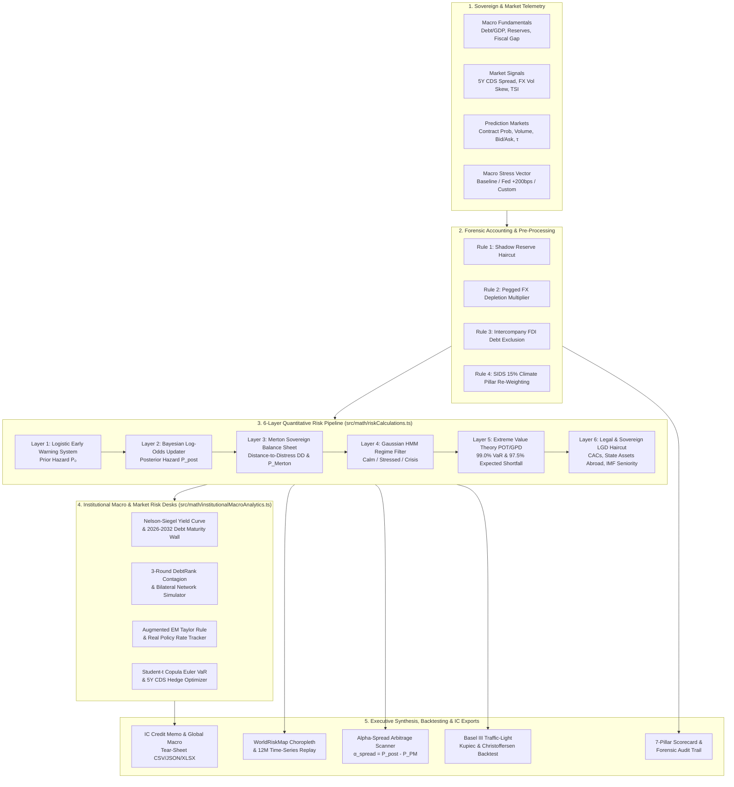

# EconQuest — Sovereign Tail-Risk & Macroeconomic Arbitrage Desk

[](./LICENSE)
[](https://www.typescriptlang.org/)
[](https://react.dev/)
[](https://vitejs.dev/)
[](https://d3js.org/)
[](https://tailwindcss.com/)

**EconQuest** is an institutional-grade quantitative sovereign risk engineering and cross-market arbitrage platform. It unifies a **6-Layer Quantitative Default & Tail-Risk Pipeline** with a **7-Pillar Macroeconomic Vulnerability Scorecard**, **Prediction Market Arbitrage Detection ($\alpha_{\text{spread}}$)**, an interactive **D3.js Natural Earth Choropleth Map with 12-Month Historical Replay**, and **Basel III FRTB Backtesting**.

> **Zero External Key Requirement**: All econometric models, Bayesian log-odds updaters, Merton structural balance sheet solvers, Extreme Value Theory (POT/GPD) tail estimators, and historical simulations run deterministically in TypeScript with zero API keys required.

---

## Table of Contents

1. [Executive Overview & Core Capabilities](#1-executive-overview--core-capabilities)
2. [System Architecture](#2-system-architecture)
3. [Quantitative Methodology & Mathematical Formulation](#3-quantitative-methodology--mathematical-formulation)
   - [6-Layer Quantitative Risk Pipeline](#31-the-6-layer-quantitative-risk-pipeline)
   - [7-Pillar Macroeconomic Vulnerability Scorecard](#32-the-7-pillar-macroeconomic-vulnerability-scorecard)
   - [Cross-Market Arbitrage Alpha ($\alpha_{\text{spread}}$)](#33-cross-market-arbitrage-alpha-alpha_textspread)
   - [Basel III Traffic-Light Backtesting](#34-basel-iii-traffic-light-backtesting-kupiec--christoffersen)
   - [Sovereign Yield Curve Term Structure & Debt Maturity Walls](#35-sovereign-yield-curve-term-structure--debt-maturity-walls)
   - [Systemic Contagion Network & 3-Round DebtRank Simulator](#36-systemic-contagion-network--3-round-debtrank-simulator)
   - [Central Bank Policy & Open-Economy Augmented Taylor Rule](#37-central-bank-policy--open-economy-augmented-taylor-rule)
   - [Multi-Sovereign Portfolio VaR & 5Y CDS Hedge Optimizer](#38-multi-sovereign-portfolio-var--5y-cds-hedge-optimizer)
4. [Quickstart & Local Development](#4-quickstart--local-development)
5. [Repository Structure](#5-repository-structure)
6. [Extending the Desk (Adding Sovereigns & Shocks)](#6-extending-the-desk-adding-sovereigns--shocks)
7. [Empirical Case Studies & Benchmark Sovereigns](#7-empirical-case-studies--benchmark-sovereigns)
8. [Institutional Roadmap & Technical Blueprints](#8-institutional-roadmap--technical-blueprints)
9. [Academic Citation, Security & Governance](#9-academic-citation-security--governance)
10. [License & Disclaimer](#10-license--disclaimer)

---

## 1. Executive Overview & Core Capabilities

| Desk Module | Key Quantitative & Visual Features |
| :--- | :--- |
| **🌍 Global Risk Map (`WorldRiskMap`)** | Interactive D3.js Natural Earth projection choropleth with pan/zoom, maritime chokepoint overlays (Malacca, Hormuz, Bab el-Mandeb, Suez, Bosporus, Panama, Cape of Good Hope), 5 discrete traffic-light risk tiers, and a **12-Month Time-Series Replay Scrubber** (`Nov 2025 – Oct 2026`). |
| **📐 6-Layer Risk Engine (`SovereignCockpit`)** | Sequential structural + reduced-form pipeline computing Logistic EWS prior, Bayesian market-updated posterior hazard, Merton structural Distance-to-Distress ($DD$), Gaussian HMM regime state, POT/GPD $\text{VaR}_{99}$ & $\text{ES}_{97.5}$, and Legal/CAC LGD haircut. |
| **🏛️ 7-Pillar Vulnerability Scorecard (`SovereignScorecardView`)** | Granular 0–100 scoring across Fiscal, External, Institutional, Political, Macro, Security, and Climate/SIDS pillars with automated **Forensic Accounting Rules** (Rule 3 Intercompany FDI filtering, Pegged FX depletion penalty, and 15% Small Island Developing State weight reallocation). |
| **📉 Yield Curve & Debt Maturity Wall (`YieldCurveMaturityDesk`)** | Parametric **Nelson-Siegel** yield curve fitting (1Y–30Y USD Eurobonds, Local Currency, and US Treasury benchmark), 2s10s slope inversion detector, 5Y CDS-bond basis arbitrage tracker, Gross Financing Need ($\text{GFN}$), and **2026–2032 Sovereign Debt Maturity Walls** against net FX reserves. |
| **🕸️ Systemic Contagion Network (`ContagionCascadeDesk`)** | Interactive D3.js bilateral spillover network and **3-Round DebtRank Contagion Simulator** propagating sovereign default shocks across Trade, BIS Banking Claims, and Global EM Portfolio channels. |
| **🏦 Central Bank Policy & Taylor Rule (`CentralBankPolicyDesk`)** | Tracks G10/EM policy rates against an open-economy **Augmented Taylor Rule**, quantifying behind-the-curve policy rate gaps, ex-post real interest rates, FX pass-through sensitivity, and REER valuation misalignment. |
| **💼 Portfolio VaR & Hedge Optimizer (`PortfolioVarOptimizerDesk`)** | Multi-sovereign bond book builder with **Student-$t$ Copula ($\nu = 4$) Euler Component VaR** decomposition, diversification benefit calculation, and an automated **5Y CDS Hedge Ratio Optimizer**. |
| **⚡ Prediction Market Arbitrage ($\alpha_{\text{spread}}$)** | Real-time divergence engine comparing calibrated model posterior hazard against live prediction market contract probabilities (Polymarket / Kalshi) adjusted for order-book depth ($\tau$) and bid-ask micro-structure. |
| **📄 IC Tear-Sheet Exporter (`IcTearSheetModal`)** | Interactive **Investment Committee (IC) Credit Memo & Global Macro Pack** generator with 1-click **CSV / JSON / XLSX** quantitative snapshot exports. |
| **📚 White Paper, Roadmap & Architecture Explorer (`WhitePaperViewer`)** | Embedded white paper PDF reader plus interactive browser for the 10-module mathematical specification, 2026–2027 engineering roadmap (`ROADMAP.md`), release history (`CHANGELOG.md`), and academic citation metadata (`CITATION.cff`). |

---

## 2. System Architecture



---

## 3. Quantitative Methodology & Mathematical Formulation

All mathematical implementations reside in pure, side-effect-free TypeScript modules under [`src/math/`](./src/math/).

### 3.1 The 6-Layer Quantitative Risk Pipeline

#### Layer 1: Logistic Early Warning System (EWS Prior)
Transforms fundamental macroeconomic balance-sheet ratios into an initial 12-month prior default probability $P_0$:

$$z_0 = \beta_0 + \beta_1 \left(\frac{\text{Debt}}{\text{GDP}}\right) + \beta_2 \left(\frac{\text{ST FX Debt}^{*}}{\text{Reserves}}\right) - \beta_3 (\text{Import Cover}) + \beta_4 (\text{Primary Deficit}) + \beta_5 (\text{PITF}) - \beta_6 (\Delta \text{Commodity})$$

$$P_0 = \sigma(z_0) = \frac{1}{1 + e^{-z_0}}$$

*Forensic Rule 3 Adjustment*: $\text{ST FX Debt}^{*}$ explicitly strips out non-callable intercompany Foreign Direct Investment (FDI) debt (e.g., Chile mining parent-subsidiary loans) to prevent false-positive external debt alarms.

#### Layer 2: Bayesian Market Signal Log-Odds Updating
Updates the EWS prior log-odds $\ln\left(\frac{P_0}{1 - P_0}\right)$ using high-frequency market log-likelihood ratios ($LLR$) from 5Y Credit Default Swaps (CDS), 25-delta FX risk-reversal volatility skew, NLP Text Stress Index ($\text{TSI}$), and liquidity-weighted prediction market contracts:

$$\ln\left(\frac{P_{\text{post}}}{1 - P_{\text{post}}}\right) = \ln\left(\frac{P_0}{1 - P_0}\right) + w_{\text{CDS}} \cdot LLR_{\text{CDS}} + w_{\text{FX}} \cdot LLR_{\text{FX}} + w_{\text{TSI}} \cdot LLR_{\text{TSI}} + \tau^{*} \cdot LLR_{\text{PM}}$$

where the prediction market confidence weight $\tau^{*} = \frac{\tau}{1 + \tau}$ scales with order-book depth and tight bid-ask spreads.

#### Layer 3: Structural Merton Sovereign Balance Sheet Model
Models sovereign solvency using a contingent-claims structural framework where $V_A$ is effective sovereign fiscal & reserve asset value, $D_B$ is the distress barrier, and $\sigma_A$ is asset volatility:

$$DD = \frac{\ln(V_A / D_B) + \left(\mu - \frac{1}{2}\sigma_A^2\right)T}{\sigma_A \sqrt{T}}, \qquad P_{\text{Merton}} = \Phi(-DD)$$

#### Layer 4: Gaussian Hidden Markov Model (HMM) Regime Switching
Classifies the sovereign into one of three latent macro-financial volatility states $S_t \in \{\text{Calm}, \text{Stressed}, \text{Crisis}\}$ based on composite market stress scores and transition probability matrices $\mathbf{P}_{ij}$.

#### Layer 5: Extreme Value Theory (POT / Generalized Pareto Distribution) Tail Risk
Models credit spread and sovereign bond loss distributions beyond a high threshold $u$ using the Generalized Pareto Distribution (GPD) with tail shape parameter $\xi > 0$ and scale $\beta$:

$$\text{VaR}_{\alpha} = u + \frac{\beta}{\xi} \left[ \left( \frac{n}{N_u}(1 - \alpha) \right)^{-\xi} - 1 \right]$$

$$\text{ES}_{\alpha} = \frac{\text{VaR}_{\alpha}}{1 - \xi} + \frac{\beta - \xi u}{1 - \xi}$$

Produces both **99.0% Value-at-Risk ($\text{VaR}_{99}$)** and **97.5% Expected Shortfall ($\text{ES}_{97.5}$)** in accordance with Basel III Fundamental Review of the Trading Book (FRTB) guidelines.

#### Layer 6: Legal & Institutional LGD Haircut
Adjusts Loss Given Default ($\text{LGD}$) for creditor holdout litigation risk, presence of enhanced Collective Action Clauses (CACs), attachable commercial state assets abroad ($>\$10\text{B}$ threshold), and IMF catalytic lending seniority.

---

### 3.2 The 7-Pillar Macroeconomic Vulnerability Scorecard

Each sovereign is evaluated across 7 structural pillars $P_1, \dots, P_7 \in [0, 100]$:

| Pillar | Standard Weight | SIDS / Island Weight | Core Indicators |
| :--- | :---: | :---: | :--- |
| **P1: Fiscal & Debt Sustainability** | 20% | 17% | Public Debt/GDP, Primary Balance Gap, Interest-to-Revenue |
| **P2: External & FX Fragility** | 20% | 18% | Filtered ST FX Debt/Reserves, Import Cover Months, FX Regime |
| **P3: Institutional & Legal Integrity** | 15% | 13% | Rule of Law, CAC Coverage, Central Bank Independence |
| **P4: Political Dynamics & Polarization** | 15% | 13% | PITF Regime Fragility, Election Contestation, Reform Mandate |
| **P5: Macroeconomic & Commodity Exposure** | 15% | 12% | Terms-of-Trade Shock Sensitivity, CPI Pass-Through |
| **P6: Security, Conflict & Chokepoints** | 10% | 12% | Armed Conflict Exposure, Maritime Chokepoint Dependency |
| **P7: Climate & Natural Catastrophe** | **5%** | **15%** | Hurricane/Typhoon Tail Risk, Coastal GDP Concentration, Blue Bonds |

---

### 3.3 Cross-Market Arbitrage Alpha ($\alpha_{\text{spread}}$)

The desk continuously computes the **Alpha-Spread** ($\alpha_{\text{spread}}$), defined as the divergence (in percentage points) between the calibrated 6-Layer Posterior Default Hazard and the implied probability of the sovereign's prediction market contract:

$$\alpha_{\text{spread}} = P_{\text{calibrated}} - P_{\text{PM}}$$

- **$\alpha_{\text{spread}} > +2.5\%$ (Underpriced Sovereign Risk — `BUY PROTECTION / YES`)**: Fundamental and credit-market stress exceeds prediction market pricing. Actionable signal to buy credit protection or accumulate "Yes" restructuring shares.
- **$\alpha_{\text{spread}} < -2.5\%$ (Overpriced Sovereign Panic — `SELL PROTECTION / NO`)**: Retail prediction market participants are overpricing headline noise relative to sovereign reserve buffers and forensic balance sheet reality (e.g., FDI debt misinterpretation).
- **$|\alpha_{\text{spread}}| \le 2.5\%$ (`NEUTRAL / FAIR VALUE`)**: Cross-market equilibrium within bid-ask transaction bounds.

---

### 3.4 Basel III Traffic-Light Backtesting (Kupiec & Christoffersen)

The platform validates model calibration across a 250-day rolling institutional trading window using:
1. **Kupiec Proportion of Failures (POF) Likelihood Ratio Test ($LR_{\text{POF}}$)**: Tests whether the empirical exception frequency matches the nominal 99.0% confidence level:
   $$LR_{\text{POF}} = -2 \ln \left[ \frac{(1 - p)^{T - x} p^x}{\left(1 - \frac{x}{T}\right)^{T - x} \left(\frac{x}{T}\right)^x} \right] \sim \chi^2_1$$
2. **Christoffersen Independence Test ($LR_{\text{ind}}$)**: Tests whether VaR breaches cluster serially during regime transitions.
3. **Joint Conditional Coverage ($LR_{\text{cc}} = LR_{\text{POF}} + LR_{\text{ind}}$)**: Classifies the model into Basel III **Green Zone** (0–4 breaches), **Yellow Zone** (5–9 breaches), or **Red Zone** ($\ge 10$ breaches).

---

### 3.5 Sovereign Yield Curve Term Structure & Debt Maturity Walls

Implemented in [`src/math/institutionalMacroAnalytics.ts`](./src/math/institutionalMacroAnalytics.ts) and rendered in [`YieldCurveMaturityDesk.tsx`](./src/components/YieldCurveMaturityDesk.tsx):

#### 1. Parametric Nelson-Siegel Term Structure ($1\text{Y}$ to $30\text{Y}$ Tenors)
Models sovereign USD Eurobond yields $y_{\text{USD}}(\tau)$ and Local Currency sovereign yields $y_{\text{LCY}}(\tau)$ at maturity $\tau \in \{1, 2, 3, 5, 7, 10, 20, 30\}$ years as a function of long-run level ($\beta_0$), short-end distress slope ($\beta_1$), medium-term hump/curvature ($\beta_2$), and decay factor $\lambda$:

$$y(\tau) = \beta_0 + \beta_1 \left(\frac{1 - e^{-\lambda \tau}}{\lambda \tau}\right) + \beta_2 \left(\frac{1 - e^{-\lambda \tau}}{\lambda \tau} - e^{-\lambda \tau}\right) + \Delta y_{\text{shock}}(\tau)$$

When a sovereign enters acute distress ($P_{\text{post}} > 20\%$ or $\text{CDS}_{5\text{Y}} > 800\text{ bps}$), front-end credit jump risk drives $\beta_1 > 0$, inverting the **2s10s slope** ($S_{2\text{s}10\text{s}} = y(10) - y(2) < 0$) as investors price near-term restructuring recovery value across all maturities.

#### 2. 5Y CDS-Bond Basis & Gross Financing Need ($\text{GFN}$)
The arbitrage basis between synthetic credit protection and cash Eurobonds is tracked as:

$$\text{Basis}_{5\text{Y}} = \text{CDS}_{5\text{Y}} - \left( y_{\text{USD}}(5) - y_{\text{UST}}(5) \right) \times 100 \quad (\text{in bps})$$

Annual **2026–2032 Debt Maturity Walls** aggregate amortization schedules across four creditor tiers (Eurobonds $D_t^{\text{Euro}}$, IMF/Multilateral $D_t^{\text{Multi}}$, Bilateral Paris/Non-Paris Club $D_t^{\text{Bilat}}$, and Domestic Local Currency $D_t^{\text{Dom}}$). The sovereign **Rollover Coverage Ratio** against net usable liquid FX reserves $R_{\text{net}}$ is:

$$\text{GFN}_t = \text{Primary Deficit}_t + i_{\text{eff},t} \cdot D_{t-1} + D_t^{\text{Euro}} + D_t^{\text{Multi}} + D_t^{\text{Bilat}} + D_t^{\text{Dom}}, \qquad \text{Reserve Cover}_t = \frac{R_{\text{net}}}{D_t^{\text{FX Service}}}$$

---

### 3.6 Systemic Contagion Network & 3-Round DebtRank Simulator

Implemented in [`src/math/institutionalMacroAnalytics.ts`](./src/math/institutionalMacroAnalytics.ts) and rendered in [`ContagionCascadeDesk.tsx`](./src/components/ContagionCascadeDesk.tsx):

#### 1. Multi-Channel Bilateral Transmission Matrix ($\mathbf{W}$)
Constructs a directed weighted adjacency matrix $W_{ij} \in [0, 1]$ measuring how distress in origin sovereign $i$ transmits to counterparty sovereign $j$ across three structural channels:

$$W_{ij} = \omega_{\text{trade}} W_{ij}^{\text{trade}} + \omega_{\text{bank}} W_{ij}^{\text{BIS}} + \omega_{\text{port}} W_{ij}^{\text{EMBI}}$$

where $W_{ij}^{\text{trade}}$ captures bilateral export/supply-chain elasticity, $W_{ij}^{\text{BIS}}$ captures BIS locational cross-border banking claims relative to Tier-1 capital, and $W_{ij}^{\text{EMBI}}$ captures common institutional EM bond fund rebalancing beta.

#### 2. 3-Round DebtRank Distress Propagation
Adapted from Battiston et al. (2012), each sovereign node $i$ has a continuous distress state $h_i(t) \in [0, 1]$ (where $h_i = 1$ denotes sovereign payment moratorium/default) and reserve absorption buffer $b_i \in [0, 1]$. Given an initial shock $\Delta h_s(0)$ at epicenter sovereign $s$, distress propagates over rounds $t = 1, 2, 3$:

$$h_i(t) = \min\left(1, \; h_i(t-1) + \gamma_{\text{regime}} \cdot \lambda_{\text{decay}}^{t-1} \sum_{j \in \mathcal{A}(t-1)} W_{ji} \cdot \Delta h_j(t-1) \cdot (1 - b_i)\right)$$

$$\Delta \text{CDS}_i(t) = \kappa_{\text{CDS}} \cdot \left(h_i(t) - h_i(0)\right) \cdot \text{LGD}_i$$

where $\mathcal{A}(t-1)$ is the set of newly distressed nodes in round $t-1$ (preventing infinite cyclic self-amplification) and $\gamma_{\text{regime}} \in \{1.0, 1.25, 1.55\}$ scales transmission speed under `Calm`, `Stressed`, or `Crisis` HMM states.

---

### 3.7 Central Bank Policy & Open-Economy Augmented Taylor Rule

Implemented in [`src/math/institutionalMacroAnalytics.ts`](./src/math/institutionalMacroAnalytics.ts) and rendered in [`CentralBankPolicyDesk.tsx`](./src/components/CentralBankPolicyDesk.tsx):

#### 1. Exchange-Rate & Pass-Through Augmented Taylor Rule
Standard closed-economy Taylor rules fail in emerging and frontier markets where exchange-rate depreciation rapidly feeds headline CPI and inflates unhedged FX debt service. EconQuest models the prescriptive nominal policy rate $i_t^{\text{Taylor}}$ as:

$$i_t^{\text{Taylor}} = r_i^* + \pi_t + \phi_{\pi} (\pi_t - \pi_i^*) + \phi_y (y_t - y_i^*) + \gamma_{\text{FX}} \cdot \Delta e_t^{\text{REER}}$$

where:
- $r_i^*$: Sovereign equilibrium neutral real interest rate (incorporating sovereign risk premium).
- $\pi_t, \pi_i^*$: Realized headline Y/Y inflation and central bank inflation target ($\phi_{\pi} = 0.5$).
- $y_t - y_i^*$: Real GDP output gap ($\phi_y = 0.5$).
- $\gamma_{\text{FX}} \cdot \Delta e_t^{\text{REER}}$: Open-economy exchange-rate depreciation pass-through premium required to defend external balance and anchor inflation expectations.

#### 2. Policy Rate Gap & Ex-Post Real Interest Rate Cushion
The desk evaluates monetary orthodoxy via the **Policy Rate Gap** ($\Delta i_t$) and **Real Interest Rate** ($r_t^{\text{real}}$):

$$\Delta i_t = i_t^{\text{actual}} - i_t^{\text{Taylor}}, \qquad r_t^{\text{real}} = i_t^{\text{actual}} - \pi_t$$

- **$\Delta i_t < -150\text{ bps}$ (`BEHIND THE CURVE`)**: Monetary policy is structurally too loose relative to inflation and FX depreciation pressure, accelerating reserve burn.
- **$\Delta i_t \ge +50\text{ bps}$ (`AHEAD OF THE CURVE / ORTHODOX`)**: Restrictive real rate buffer actively defending currency stability and disinflation.

---

### 3.8 Multi-Sovereign Portfolio VaR & 5Y CDS Hedge Optimizer

Implemented in [`src/math/institutionalMacroAnalytics.ts`](./src/math/institutionalMacroAnalytics.ts) and rendered in [`PortfolioVarOptimizerDesk.tsx`](./src/components/PortfolioVarOptimizerDesk.tsx):

#### 1. Student-$t$ Copula ($\nu = 4$) Stress Covariance & Tail Dependence
Given a multi-sovereign bond book with notional weights $\mathbf{w} = (w_1, \dots, w_N)^\top$ ($\sum_{i=1}^N w_i = 1$) and individual Layer-5 99% tail loss volatilities $\boldsymbol{\sigma}$, pairwise correlations $\rho_{ij}$ are stressed via a **Student-$t$ Copula with $\nu = 4$ degrees of freedom**, which captures upper-tail co-movement during global liquidity squeezes:

$$\rho_{ij}^{\text{stress}} = \min\left(0.95, \; \rho_{ij}^{\text{base}} + \theta_{\text{stress}} (1 - \rho_{ij}^{\text{base}})\right), \qquad \Sigma_{ij} = \rho_{ij}^{\text{stress}} \cdot \text{VaR}_{99, i} \cdot \text{VaR}_{99, j}$$

$$\text{VaR}_{99}(P) = \kappa_{t(\nu=4)} \sqrt{\mathbf{w}^\top \boldsymbol{\Sigma} \mathbf{w}}, \qquad \text{Diversification Benefit} = \sum_{i=1}^N w_i \text{VaR}_{99,i} - \text{VaR}_{99}(P)$$

#### 2. Euler Homogeneous Risk Allocation (Marginal & Component VaR)
By Euler's homogeneous function theorem, total portfolio $\text{VaR}_{99}(P)$ decomposes exactly into additive sovereign **Component VaR ($\text{CVaR}_i$)** contributions:

$$\text{MVaR}_i = \frac{\partial \text{VaR}_{99}(P)}{\partial w_i} = \frac{(\boldsymbol{\Sigma} \mathbf{w})_i}{\sqrt{\mathbf{w}^\top \boldsymbol{\Sigma} \mathbf{w}}} \cdot \kappa_{t(\nu=4)}, \qquad \text{CVaR}_i = w_i \cdot \text{MVaR}_i, \qquad \sum_{i=1}^N \text{CVaR}_i = \text{VaR}_{99}(P)$$

#### 3. Automated 5Y CDS Protection Hedge Optimizer
Given a target maximum annual carry budget or target hedge ratio $h_i \in [0, 1]$ per position, the optimizer ranks sovereigns by their **Tail-Risk Reduction per Basis Point of CDS Carry Efficiency ($\eta_i$)**:

$$\eta_i = \frac{\text{CVaR}_i / w_i}{\text{CDS}_{5\text{Y}, i} \text{ (bps)}}, \qquad \text{VaR}_{99}^{\text{hedged}}(P) = \text{VaR}_{99}\left(\mathbf{w} \odot (\mathbf{1} - \beta_{\text{basis}} \mathbf{h})\right)$$

where $\beta_{\text{basis}} \in (0, 1]$ accounts for imperfect CDS-to-cash bond basis correlation during restructuring auctions.

---

## 4. Quickstart & Local Development

### Prerequisites
- **Node.js** `>= 20.x` (or **Bun** `>= 1.1`)
- **npm** `>= 10.x`

### Installation & Running Locally

```bash
# 1. Clone the repository
git clone https://github.com/your-org/econquest-sovereign-risk-desk.git
cd econquest-sovereign-risk-desk

# 2. Install dependencies
npm install

# 3. Copy environment template (optional — zero keys required for core engine)
cp .env.example .env

# 4. Start the development server on http://localhost:3000
npm run dev
```

### Verification & Production Build

```bash
# Run strict TypeScript type-checking
npm run lint

# Build optimized production bundle to ./dist
npm run build

# Preview production build locally
npm run preview
```

---

## 5. Repository Structure

```text
econquest-sovereign-risk-desk/
├── .github/
│   ├── ISSUE_TEMPLATE/          # Bug report & quantitative model enhancement templates
│   ├── PULL_REQUEST_TEMPLATE.md # PR verification & benchmark calibration checklist
│   └── workflows/
│       └── ci.yml               # Automated GitHub Actions typecheck & build pipeline
├── docs/
│   ├── ARCHITECTURE.md                  # Deep-dive mathematical & TypeScript architecture guide
│   ├── DATA_API_ARCHITECTURE.md         # Multi-tier macro, market, geopolitical & scraper API specs
│   ├── AI_AGENT_ARCHITECTURE.md         # Function-calling VaR agent, Article IV NLP & IC Debate specs
│   └── MOBILE_AND_ENTERPRISE_SPECS.md   # Offline PWA, iOS/Android push companion & SR 11-7 governance
├── src/
│   ├── components/
│   │   ├── WorldRiskMap.tsx             # D3 Natural Earth Choropleth & 12M Replay Engine
│   │   ├── SovereignCockpit.tsx         # Executive 6-Layer synthesis & institutional quick-jump widgets
│   │   ├── YieldCurveMaturityDesk.tsx   # Nelson-Siegel curves, 2s10s slope & 2026-2032 Maturity Walls
│   │   ├── ContagionCascadeDesk.tsx     # Bilateral network graph & 3-round DebtRank cascade simulator
│   │   ├── CentralBankPolicyDesk.tsx    # Augmented Taylor Rule monitor, real rates & REER misalignment
│   │   ├── PortfolioVarOptimizerDesk.tsx# Student-t Copula Euler VaR & automated CDS hedge optimizer
│   │   ├── IcTearSheetModal.tsx         # Interactive Investment Committee Tear-Sheet & snapshot exporter
│   │   ├── SovereignScorecardView.tsx   # 7-Pillar Vulnerability Scorecard & Forensic Audit
│   │   ├── SovereignComparison.tsx      # Multi-sovereign radar & cross-country matrix
│   │   ├── ScenarioBuilderModal.tsx     # Custom macro stress vector builder
│   │   └── WhitePaperViewer.tsx         # In-app White Paper, Roadmap & Open-Source Architecture Explorer
│   ├── data/
│   │   ├── sovereignData.ts             # Calibrated sovereign profiles & market telemetry
│   │   ├── worldGeoData.ts              # GeoJSON sovereign polygons, chokepoints & risk scales
│   │   ├── historicalMapData.ts         # 12-month time-series progression generator
│   │   └── historicalScorecardData.ts   # Historical crisis trajectory datasets
│   ├── math/
│   │   ├── riskCalculations.ts          # 6-Layer Risk Pipeline, Merton, Bayesian & POT/GPD math
│   │   ├── scorecardCalculations.ts     # 7-Pillar Scorecard & Forensic Accounting rules
│   │   └── institutionalMacroAnalytics.ts # Nelson-Siegel, DebtRank, Taylor Rule & Copula VaR engine
│   ├── types/
│   │   └── riskEngine.ts                # Core TypeScript interfaces & domain models
│   ├── utils/
│   │   └── exportUtils.ts               # Institutional CSV, JSON & multi-sheet XLSX export
│   ├── App.tsx                          # Main Risk Intelligence workspace & desk navigation
│   └── main.tsx                         # Application entry point
├── .env.example                 # Environment variable template
├── CHANGELOG.md                 # Full semantic version release history (v1.0.0 - v2.4.0)
├── CITATION.cff                 # Academic & institutional Citation File Format metadata
├── CODE_OF_CONDUCT.md           # Contributor Covenant Code of Conduct
├── CONTRIBUTING.md              # Contribution guidelines & calibration standards
├── LICENSE                      # MIT License
├── ROADMAP.md                   # Institutional 2026-2027 product & engineering roadmap
├── SECURITY.md                  # Client-side execution guarantees & vulnerability policy
├── package.json                 # Dependencies & verification scripts
└── README.md                    # Project documentation
```

---

## 6. Extending the Desk (Adding Sovereigns & Shocks)

### Adding a New Monitored Sovereign

1. **Add the Sovereign Profile** in [`src/data/sovereignData.ts`](./src/data/sovereignData.ts) implementing the `SovereignEntity` interface:
   ```ts
   {
     id: 'brazil',
     name: 'Brazil',
     code: 'BRA', // Matches ISO-3166-1 alpha-3 id in WORLD_COUNTRIES_GEO
     flag: '🇧🇷',
     region: 'Latin America',
     isIslandState: false,
     fxRegime: 'Floating',
     publicDebtToGdp: 74.8,
     shortTermFxDebtToReserves: 24.5,
     netReservesToImportsMonths: 14.2,
     // ... market signals, Merton parameters, and 7-pillar scores
   }
   ```
2. **Verify Map Geometry**: Ensure the `code` matches an ISO-3 entry in `WORLD_COUNTRIES_GEO` inside [`src/data/worldGeoData.ts`](./src/data/worldGeoData.ts). Note that `WorldRiskMap.tsx` automatically normalizes spherical polygon winding order (`d3.geoArea <= 2π`).

---

## 7. Empirical Case Studies & Benchmark Sovereigns

The platform comes pre-calibrated with 10 benchmark sovereign profiles spanning investment-grade anchors, frontier restructurings, and active stress cases:

- **🇨🇱 Chile (`CHL`)**: Investment-grade sovereign benchmark demonstrating **Forensic Rule 3** (filtering intercompany mining FDI debt prevents false external fragility signals).
- **🇧🇿 Belize (`BLZ`)**: Small Island / Coastal State case study demonstrating **Pillar 7 (15% Climate Weight Rule)** and Blue Bond debt-for-nature restructuring dynamics.
- **📊 Section 8 Frontier Case Study (`SEC8`)**: Canonical walkthrough from the quantitative white paper illustrating cross-market arbitrage divergence ($\alpha_{\text{spread}}$).
- **🇱🇰 Sri Lanka (`LKA`)**, **🇬🇭 Ghana (`GHA`)**, **🇦🇷 Argentina (`ARG`)**, **🇵🇰 Pakistan (`PAK`)**, **🇹🇷 Turkey (`TUR`)**, **🇮🇩 Indonesia (`IDN`)**, and **🇿🇦 South Africa (`ZAF`)**.

---

## 8. Institutional Roadmap & Technical Blueprints

For the complete 2026–2027 institutional engineering roadmap—covering planned quantitative modules (Sovereign Debt Restructuring & CAC Simulator, FX Capital Controls & NDF Monitor, Commodity Chokepoint Elasticity, Intraday Liquidity/Repo Stress), real-time API ingestion, Agentic AI workflows, Mobile/PWA delivery, and SR 11-7 governance—refer to our dedicated specification suite:

- 🗺️ [**Institutional Product & Engineering Roadmap (`ROADMAP.md`)**](./ROADMAP.md)
- 📐 [**Mathematical & System Architecture (`docs/ARCHITECTURE.md`)**](./docs/ARCHITECTURE.md)
- 🔌 [**Multi-Tier Data & Real-Time API Blueprint (`docs/DATA_API_ARCHITECTURE.md`)**](./docs/DATA_API_ARCHITECTURE.md)
- 🤖 [**Agentic AI, Function-Calling & IC Debate Architecture (`docs/AI_AGENT_ARCHITECTURE.md`)**](./docs/AI_AGENT_ARCHITECTURE.md)
- 📱 [**Mobile/PWA Companion & SR 11-7 Enterprise Governance (`docs/MOBILE_AND_ENTERPRISE_SPECS.md`)**](./docs/MOBILE_AND_ENTERPRISE_SPECS.md)
- 📋 [**Release History & Changelog (`CHANGELOG.md`)**](./CHANGELOG.md)

---

## 9. Academic Citation, Security & Governance

### Citing EconQuest in Academic & Policy Research
If you use EconQuest or its quantitative sovereign risk models in academic research, central bank working papers, or institutional risk memos, please cite using [`CITATION.cff`](./CITATION.cff) or the following BibTeX entry:

```bibtex
@manual{econquest2026sovereign,
  title        = {EconQuest: Sovereign Tail-Risk and Geopolitical Information Asymmetry — A Quantitative VaR Framework for Macroeconomic Arbitrage},
  author       = {{EconQuest Quantitative Sovereign Risk Research Group}},
  year         = {2026},
  month        = {10},
  version      = {2.4.0},
  url          = {https://github.com/your-org/econquest-sovereign-risk-desk},
  note         = {Open-Source Quantitative Sovereign Risk & Macroeconomic Market Intelligence Platform}
}
```

### Open-Source Governance & Security
- 🤝 [**Contributing Guide (`CONTRIBUTING.md`)**](./CONTRIBUTING.md) — Coding standards, Euler VaR invariants, and calibration verification checklist.
- 🛡️ [**Security Policy (`SECURITY.md`)**](./SECURITY.md) — Client-side deterministic execution guarantees and vulnerability disclosure protocol.
- 📜 [**Code of Conduct (`CODE_OF_CONDUCT.md`)**](./CODE_OF_CONDUCT.md) — Contributor Covenant community standards.

---

## 10. License & Disclaimer

Distributed under the **MIT License**. See [`LICENSE`](./LICENSE) for full license text.

*Disclaimer: EconQuest is an open-source quantitative research and educational tool. It does not constitute financial, legal, or investment advice.*
