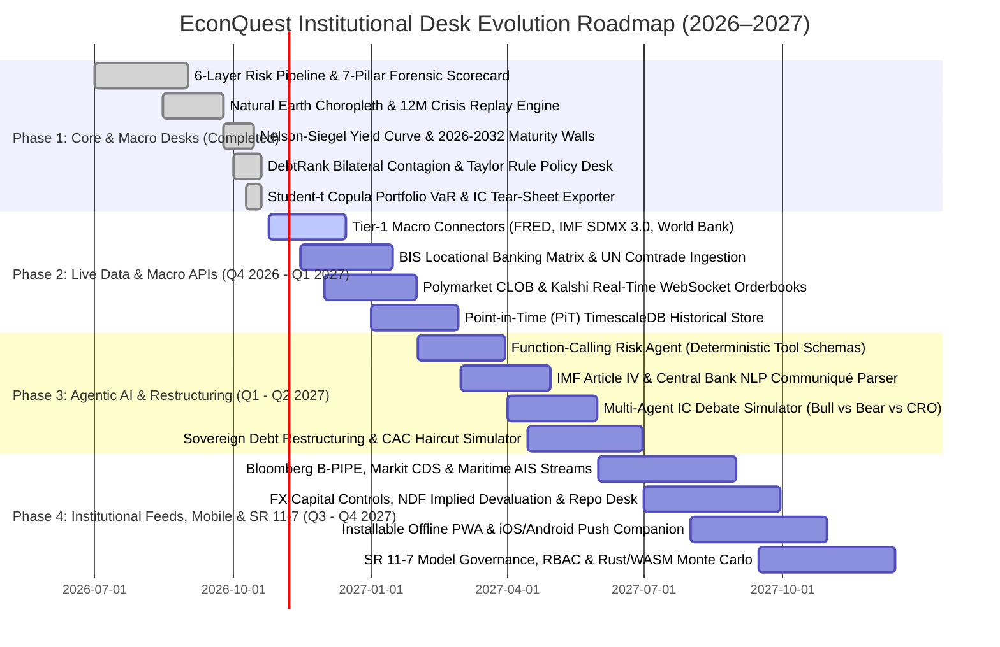

# EconQuest — Institutional Sovereign Macroeconomic Risk Desk Roadmap

This document defines the strategic product, quantitative engineering, real-time data ingestion, agentic AI, mobile delivery, and regulatory governance roadmap to evolve **EconQuest** into a full-scale institutional sovereign macroeconomic risk and cross-market arbitrage terminal.

---

## Quick Navigation to Technical Blueprints

| Specification Document | Scope & Engineering Coverage |
| :--- | :--- |
| [**`docs/ARCHITECTURE.md`**](./docs/ARCHITECTURE.md) | 6-Layer Risk Engine, 7-Pillar Forensic Scorecard, Nelson-Siegel Yield Curves, DebtRank Contagion, Taylor Rule Policy Tracker, and Euler Portfolio VaR attribution. |
| [**`docs/DATA_API_ARCHITECTURE.md`**](./docs/DATA_API_ARCHITECTURE.md) | Multi-tier real-time ingestion across Official Macro APIs (FRED, IMF SDMX, BIS, World Bank), Institutional Market Feeds (Bloomberg B-PIPE, Markit CDS, LSEG), Geopolitical Streams (GDELT, ACLED, AIS Maritime), and Central Bank Document Scrapers. |
| [**`docs/AI_AGENT_ARCHITECTURE.md`**](./docs/AI_AGENT_ARCHITECTURE.md) | Deterministic Function-Calling Agent schemas wrapping the 6-Layer VaR Engine, Automated NLP Parser for IMF Article IV & Central Bank communiqués, and the Multi-Agent Investment Committee (IC) Bull vs. Bear Debate Simulator. |
| [**`docs/MOBILE_AND_ENTERPRISE_SPECS.md`**](./docs/MOBILE_AND_ENTERPRISE_SPECS.md) | Installable PWA offline engine, Native iOS/Android React Native companion app, real-time APNs/FCM regime-shift push alerts, WebAssembly Monte Carlo acceleration, and Federal Reserve **SR 11-7** Model Risk Governance. |

---

## 1. Executive Release Horizon (Q4 2026 – Q4 2027)

---

## 2. Pillar I: Planned Quantitative & Sovereign Desk Modules

Beyond the currently operational 13 workbench desks, four specialized institutional trading and restructuring modules are scheduled for Phases 3 and 4:

### 2.1 Sovereign Debt Restructuring & CAC Haircut Simulator (`RestructuringDesk`)
Designed for distressed sovereign credit analysts, creditor committees, and IMF program negotiators:
- **Collective Action Clause (CAC) Voting Engine**:
  - Models bond-by-bond vs. two-limb aggregated voting thresholds ($66.7\%$ aggregate + $50\%$ per series vs. $75\%$ single-limb ICMA enhanced CACs).
  - Identifies series vulnerable to **holdout creditor blocking positions** ($>25.1\%$ concentration in short-dated Eurobonds).
- **Exit-Yield NPV Haircut Matrix**:
  - Interactive grid computing Net Present Value (NPV) recovery across exit yields ($8\% \text{ to } 18\%$), maturity extensions ($+3\text{Y to } +12\text{Y}$), principal face-value haircuts ($0\% \text{ to } 50\%$), and step-up coupon structures.
- **State-Contingent Debt Instruments (SCDIs)**:
  - Pricing engines for **GDP-Linked Warrants**, **Commodity-Price Recovery Value Rights (RVRs)** (oil/copper export kickers), and **Climate Resilient Debt Clauses (CRDCs)** hurricane-pause options.
- **IMF Debt Sustainability Analysis (DSA) Solver**:
  - Solves for the minimum primary fiscal balance trajectory and debt relief required to bring Public Debt/GDP below the IMF Market-Access Country (MAC) sustainability threshold and Gross Financing Needs (GFN) below $15\%$ of GDP by year $T+5$.

### 2.2 FX Capital Controls, Parallel Rates & BoP Sudden-Stop Desk (`FxRegimeDesk`)
Models currency pegs, non-deliverable forwards (NDFs), and shadow exchange rate pressures:
- **Parallel / Blue-Chip FX Spread Monitor**:
  - Tracks divergence between official central bank spot fixing and parallel/offshore market rates (e.g., CCL/MEP equity-implied FX, offshore crypto/stablecoin USDT local premiums).
- **NDF Term Structure & Implied Devaluation Hazard**:
  - Extracts 1M, 3M, 6M, and 12M implied devaluation probabilities from offshore Non-Deliverable Forward points relative to local policy interest rate differentials (Uncovered Interest Parity breakdown).
- **Full IMF ARA (Assessing Reserve Adequacy) Metric Decomposition**:
  - Computes the formal IMF composite reserve adequacy requirement across fixed vs. floating regimes:
    $$\text{ARA}_{\text{Fixed}} = 10\% \times \text{Exports} + 10\% \times \text{Broad Money (M2)} + 30\% \times \text{Short-Term Debt} + 20\% \times \text{Other Liabilities}$$
  - Flags sovereigns falling below the $100\%$ ARA adequacy floor after stripping out encumbered swap lines (**Forensic Rule 1**).

### 2.3 Commodity Terms-of-Trade & Maritime Supply Chain Shock Matrix (`CommodityChokepointDesk`)
Couples physical trade elasticity with geopolitical naval chokepoint telemetry:
- **HS-Code Bilateral Commodity Elasticity**:
  - Maps each sovereign's top 5 commodity exports (e.g., Crude Oil, LNG, Copper, Lithium, Wheat, Cocoa, Semiconductors) and strategic imports (Energy, Food, Fertilizer) to fiscal revenue and current-account balances.
- **Dynamic Maritime Chokepoint Routing Penalty**:
  - Simulates closures or insurance war-risk surcharges across **Strait of Hormuz**, **Strait of Malacca**, **Bab el-Mandeb / Red Sea**, **Suez Canal**, **Turkish Straits**, **Panama Canal**, and **Cape of Good Hope**, translating additional voyage days and freight rates into sovereign CPI inflation pass-through and import cover depletion.

### 2.4 Intraday Sovereign Liquidity, Cross-Currency Basis & Repo Stress Desk (`LiquidityRepoDesk`)
Monitors systemic dollar funding squeezes and local bond market microstructure:
- **Cross-Currency Basis Swap Tracker**:
  - Tracks 3M and 5Y cross-currency basis swaps against USD (measuring offshore synthetic dollar borrowing premiums during global risk-off episodes).
- **Federal Reserve FIMA Repo & Bilateral Swap Line Utilization**:
  - Monitors sovereign eligibility and drawings on Fed FIMA repo facilities, PBOC bilateral RMB swap lines, and multilateral liquidity facilities ( Chiang Mai Initiative, FLAR).
- **Local Bond Market Bid-Ask & Turnover Z-Score**:
  - Detects market-maker inventory exhaustion in domestic sovereign bond auctions (bid-to-cover ratio drops and primary dealer tail widening).

---

## 3. Pillar II: Multi-Tier Data & Real-Time API Architecture

Full technical specification available in [**`docs/DATA_API_ARCHITECTURE.md`**](./docs/DATA_API_ARCHITECTURE.md).

| Data Tier | Primary Providers & Endpoints | Target EconQuest Pipeline Layers | Ingestion Cadence |
| :--- | :--- | :--- | :--- |
| **Tier 1: Official Macro & Supranational** | **FRED**, **IMF SDMX 3.0** (IFS/WEO/BOP), **BIS Locational Banking**, **World Bank IDS**, **UN Comtrade** | Layer 1 EWS Fundamentals, 7-Pillar Scorecard, DebtRank Contagion Matrix $W_{ij}$, Debt Maturity Walls | Daily / Monthly Release Driven (PiT versioned) |
| **Tier 2: Institutional Market & Credit** | **Bloomberg B-PIPE (`BLPAPI`)**, **Markit Sovereign CDS**, **LSEG Elektron**, **Polymarket CLOB / Kalshi WS** | Layer 2 Bayesian Updater, Layer 3 Merton Volatility, Nelson-Siegel Curves, $\alpha_{\text{spread}}$ Scanner | Real-Time Streaming (`< 250ms` WebSocket ticks) |
| **Tier 3: Geopolitical & Maritime Telemetry** | **GDELT 2.0**, **ACLED Conflict API**, **Spire / MarineTraffic AIS**, **NOAA / IBTrACS Cyclone Tracks** | Layer 1 PITF Instability, Pillar 6 Security, Pillar 7 SIDS Climate Tail Risk, Chokepoint Overlays | 15-Minute Micro-Batch |
| **Tier 4: Sovereign Document Scrapers** | **Central Bank Policy Communiqués**, **IMF Article IV Staff Reports**, **MoF Issuance Calendars** | Layer 2 Text Stress Index ($\text{TSI}$), Central Bank Taylor Rule Stance, Auction Roll-Over Risk | Event-Driven Webhook & Headless Scraper |

---

## 4. Pillar III: Agentic AI & Quantitative Tool Integrations

Full technical specification and JSON schemas available in [**`docs/AI_AGENT_ARCHITECTURE.md`**](./docs/AI_AGENT_ARCHITECTURE.md).

1. **Deterministic Function-Calling Quantitative Agent**:
   - Prevents LLM numerical hallucination by restricting the AI agent to deterministic TypeScript/WASM function calls (`run_sovereign_stress_test`, `compute_sovereign_yield_curve`, `simulate_debtrank_contagion_cascade`, `evaluate_central_bank_taylor_rule`, `optimize_portfolio_var_and_cds_hedges`).
   - Every quantitative figure cited in an AI response includes an inline provenance badge verifying the exact function call and input parameters.
2. **Automated NLP Parser for IMF Article IV & Central Bank Communiqués**:
   - Processes multi-hundred-page IMF Article IV Staff Reports, Debt Sustainability Analyses, and Central Bank rate statements into structured quantitative telemetry:
     - **Text Stress Index ($\text{TSI} \in [0, 10]$)** feeding Layer 2 Bayesian Log-Odds.
     - **Monetary Policy Hawkish/Dovish Delta ($\Delta_{\text{stance}} \in [-1, +1]$)** and **Forensic Off-Balance-Sheet Debt Warnings** (e.g., newly disclosed SOE contingent liabilities or central bank gold swaps).
3. **Multi-Agent Investment Committee (IC) Debate Simulator**:
   - Automated adversarial workflow pitting a **Distressed Alpha Bull Agent** (arguing carry, reserve buffers, and IMF catalytic support) against a **Macro Tail-Risk Bear Agent** (citing POT/GPD $\text{ES}_{97.5}$, refinancing cliffs, and DebtRank contagion), moderated by a **Chief Risk Officer (CRO) Arbiter Agent** that outputs a sized trade ticket and CDS hedge ratio.

---

## 5. Pillar IV: Mobile Application, PWA & Enterprise Governance

Full technical specification available in [**`docs/MOBILE_AND_ENTERPRISE_SPECS.md`**](./docs/MOBILE_AND_ENTERPRISE_SPECS.md).

1. **Progressive Web App (PWA) & Offline Sovereign Triage**:
   - Service Worker caching of deterministic math engines (`src/math/`), Natural Earth GeoJSON topology, and the latest signed Point-in-Time telemetry bundle so sovereign analysts traveling on flights or field missions retain 100% interactive stress-testing capability offline.
2. **Native iOS & Android Institutional Companion (`EconQuest Mobile`)**:
   - **Real-Time Push Alert Engine (APNs / FCM)**: Instant push alerts when a sovereign crosses a Gaussian HMM regime threshold (`Calm -> Stressed -> Crisis`), when $\alpha_{\text{spread}}$ exceeds $\pm 250\text{ bps}$, or when a central bank delivers an off-consensus rate shock.
   - **Mobile Risk Triage UX**: Compact single-thumb sovereign swipe cards, interactive mini yield curves, and 1-tap IC Tear-Sheet PDF/JSON sharing.
3. **Enterprise Infrastructure & SR 11-7 Model Risk Management**:
   - **Federal Reserve SR 11-7 Governance**: Immutable audit logging of all coefficient changes, forensic rule overrides, and stress-test parameter adjustments; Champion/Challenger model parallel execution; and automated daily Kupiec POF / Christoffersen independence backtest certification.
   - **Rust / WebAssembly (WASM) Compute Acceleration**: Offloading 100,000-path Student-t Copula Monte Carlo portfolio simulations to multi-threaded WebWorkers + SIMD WebAssembly for `< 15ms` execution across 50+ sovereign issuers.

---

## 6. Institutional Readiness Checklist & Success Metrics

| Engineering Dimension | Current State (v2026.10) | Target Institutional State (v2027.4) |
| :--- | :--- | :--- |
| **Sovereign Coverage** | 10 Deep-Calibrated Benchmark Sovereigns + Global GeoJSON | 75+ EM/Frontier & G10 Sovereigns with live PiT telemetry |
| **Quantitative Pipeline Latency** | `< 2ms` synchronous TypeScript (`useMemo`) | `< 15ms` for 100,000-path Copula Monte Carlo via Rust/WASM Worker |
| **Data Freshness** | Curated benchmark snapshot + 12M replay | `< 250ms` WebSocket market ticks + daily PiT macro synchronization |
| **Model Validation** | 250-day Kupiec POF & Christoffersen backtest | Automated SR 11-7 Champion/Challenger CI gate + cryptographic audit trail |
| **Export & Reporting** | Interactive IC Tear-Sheet + CSV / JSON / XLSX | Signed PDF IC Pitchbooks, FIX Protocol trade tickets & REST/GraphQL API |
