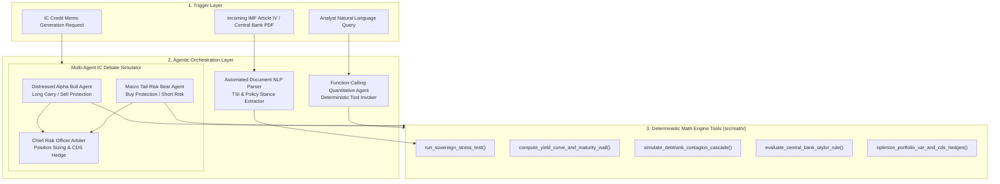

# Agentic AI & Quantitative Tool-Calling Architecture (`docs/AI_AGENT_ARCHITECTURE.md`)

This document specifies the architecture for integrating **Agentic AI Workflows**, **Deterministic Quantitative Function-Calling Tools**, **Automated IMF Article IV / Central Bank NLP Parsers**, and the **Multi-Agent Investment Committee (IC) Debate Simulator** into **EconQuest**.

---

## 1. Core Design Principle: Zero Quantitative Hallucination

In institutional sovereign credit and macroeconomic risk management, an AI system must **never** estimate, interpolate, or hallucinate probabilities, Value-at-Risk figures, yield curve nodes, or debt sustainability ratios using language model weights.

**EconQuest enforces a strict Separation of Compute and Synthesis**:
1. **Deterministic Mathematical Execution (`src/math/`)**: Every probability, Merton Distance-to-Distress ($DD$), POT/GPD Expected Shortfall ($\text{ES}_{97.5}$), Nelson-Siegel yield curve node, DebtRank contagion cascade, Taylor Rule rate gap, and Student-t copula Component VaR is computed exclusively by the pure TypeScript quantitative engine via structured tool calls.
2. **Cryptographic Provenance Citations**: Every numerical claim emitted by an agent must reference a `[ToolCallID: sha256_hash]` linking directly to the deterministic JSON output of the underlying math function.



---

## 2. Capability 1: Function-Calling Quantitative Risk Agent

The Quantitative Risk Agent is equipped with five strictly typed function declarations that wrap `src/math/riskCalculations.ts`, `src/math/scorecardCalculations.ts`, and `src/math/institutionalMacroAnalytics.ts`.

### 2.1 Tool Schema 1: `run_sovereign_stress_test`
Executes the full 6-Layer Quantitative Risk Pipeline and 7-Pillar Forensic Scorecard for one or more sovereigns under a specified or custom macroeconomic shock vector.

```json
{
  "name": "run_sovereign_stress_test",
  "description": "Executes the deterministic 6-Layer Sovereign Risk Pipeline (Logistic EWS, Bayesian Log-Odds, Merton DD, Gaussian HMM Regime, POT/GPD VaR_99 & ES_97.5, Legal LGD) and 7-Pillar Forensic Scorecard under baseline or custom macro stress parameters.",
  "parameters": {
    "type": "OBJECT",
    "properties": {
      "sovereignIds": {
        "type": "ARRAY",
        "items": { "type": "STRING" },
        "description": "Array of sovereign IDs (e.g., ['chile', 'sri_lanka', 'ghana', 'argentina', 'turkey']) or ['ALL']."
      },
      "scenario": {
        "type": "STRING",
        "enum": [
          "baseline",
          "scenarioA_fedTightening",
          "scenarioB_commodityCollapse",
          "scenarioC_malaccaBlockade",
          "custom"
        ]
      },
      "customParams": {
        "type": "OBJECT",
        "properties": {
          "interestRateShockBps": { "type": "NUMBER", "description": "US/Global rate shock in bps (-200 to +500)" },
          "commodityPriceShockPct": { "type": "NUMBER", "description": "Commodity export price shock in % (-50 to +50)" },
          "fxDevaluationShockPct": { "type": "NUMBER", "description": "FX pressure shock in % (0 to +60)" },
          "politicalContagionDelta": { "type": "NUMBER", "description": "PITF political stress delta (-3 to +5)" }
        }
      }
    },
    "required": ["sovereignIds", "scenario"]
  }
}
```

### 2.2 Tool Schema 2: `compute_yield_curve_and_maturity_wall`
Wraps `computeSovereignYieldCurve()` and `computeDebtMaturityWall()` from `src/math/institutionalMacroAnalytics.ts`.

```json
{
  "name": "compute_yield_curve_and_maturity_wall",
  "description": "Computes the parametric Nelson-Siegel sovereign yield curve (1Y-30Y USD Eurobond, Local Currency, and UST benchmark), 2s10s slope inversion status, 5Y CDS-bond basis, and 2026-2032 debt maturity wall refinancing ratio.",
  "parameters": {
    "type": "OBJECT",
    "properties": {
      "sovereignId": { "type": "STRING" },
      "scenario": { "type": "STRING" }
    },
    "required": ["sovereignId", "scenario"]
  }
}
```

### 2.3 Tool Schema 3: `simulate_debtrank_contagion_cascade`
Wraps `simulateContagionCascade()` to model multi-round cross-border sovereign default spillovers.

```json
{
  "name": "simulate_debtrank_contagion_cascade",
  "description": "Simulates a 3-round DebtRank cross-border sovereign default cascade across Trade, BIS Banking Claims, and Global EM Portfolio Rebalancing channels from a specified shock origin sovereign.",
  "parameters": {
    "type": "OBJECT",
    "properties": {
      "originSovereignId": { "type": "STRING", "description": "Origin sovereign triggering the initial distress shock" },
      "initialShockMagnitude": { "type": "NUMBER", "description": "Initial default/restructuring severity [0.10 to 1.00]" },
      "channelFilter": { "type": "STRING", "enum": ["ALL", "Trade", "Banking", "Financial"] }
    },
    "required": ["originSovereignId", "initialShockMagnitude"]
  }
}
```

### 2.4 Tool Schema 4: `evaluate_central_bank_taylor_rule`
Wraps `computeCentralBankPolicy()` to evaluate monetary policy stance and currency misalignment.

```json
{
  "name": "evaluate_central_bank_taylor_rule",
  "description": "Computes the open-economy augmented Taylor Rule implied policy rate, monetary policy rate gap (behind vs ahead of the curve), ex-post real interest rate, and REER FX valuation misalignment.",
  "parameters": {
    "type": "OBJECT",
    "properties": {
      "sovereignIds": { "type": "ARRAY", "items": { "type": "STRING" } },
      "scenario": { "type": "STRING" }
    },
    "required": ["sovereignIds", "scenario"]
  }
}
```

### 2.5 Tool Schema 5: `optimize_portfolio_var_and_cds_hedges`
Wraps `computePortfolioRiskAttribution()` and `optimizePortfolioHedges()` to run Student-t copula Euler VaR attribution and solve for optimal CDS protection overlays.

```json
{
  "name": "optimize_portfolio_var_and_cds_hedges",
  "description": "Computes multi-sovereign portfolio 99% VaR, 97.5% Expected Shortfall, Euler Component VaR decomposition, diversification benefit, and optimal 5Y CDS protection notionals.",
  "parameters": {
    "type": "OBJECT",
    "properties": {
      "positions": {
        "type": "ARRAY",
        "items": {
          "type": "OBJECT",
          "properties": {
            "sovereignId": { "type": "STRING" },
            "notionalUsdMillions": { "type": "NUMBER" },
            "cdsHedgeRatio": { "type": "NUMBER" }
          },
          "required": ["sovereignId", "notionalUsdMillions", "cdsHedgeRatio"]
        }
      },
      "autoOptimizeHedges": { "type": "BOOLEAN" }
    },
    "required": ["positions"]
  }
}
```

---

## 3. Capability 2: Automated NLP Parser for IMF Article IV & Central Bank Communiqués

The Layer 2 Bayesian Log-Odds Updater relies on the **Text Stress Index ($\text{TSI} \in [0, 10]$)**, while the Central Bank Policy Desk tracks monetary policy cycle pivots. The Automated NLP Parser converts unstructured sovereign documents into calibrated numerical signals with full sentence-level auditability.

### 3.1 Document Processing & Extraction Pipeline
1. **Structural Section Chunking**:
   - Splits IMF Article IV Staff Reports into canonical sections: *Executive Summary*, *Fiscal Policy & Debt Sustainability*, *External Sector Assessment & Reserve Adequacy*, *Monetary & Financial Sector Policy*, and *Staff Appraisal*.
   - Splits Central Bank Monetary Policy Committee (MPC) statements into *Inflation Assessment*, *Growth & Labor Market*, *External Balance*, and *Forward Guidance / Rate Decision*.
2. **Structured Rubric Scoring (Constrained JSON Output)**:
   - Evaluates each document chunk against six quantitative rubric dimensions (scored $0.0 \text{ to } 10.0$):
     - $d_1$: **Liquidity & Roll-Over Urgency** (mentions of domestic auction undersubscription, arrears, bridge loans, FX rationing).
     - $d_2$: **IMF Program Conditionality Friction** (prior actions delayed, structural benchmark waivers, financing assurances pending).
     - $d_3$: **Fiscal Slippage & Off-Balance-Sheet Liabilities** (SOE bailouts, unbudgeted energy subsidies, central bank deficit monetization).
     - $d_4$: **External Reserve Encumbrance** (gold swaps, short FX forward positions, parallel FX market spread widening).
     - $d_5$: **Political & Social Contestation of Adjustment** (anti-austerity protests, parliamentary rejection of finance bills).
     - $d_6$: **Central Bank Hawkish / Dovish Policy Tilt** ($\Delta_{\text{MPC}} \in [-1.0 \text{ Dovish}, +1.0 \text{ Hawkish}]$).
3. **Deterministic Aggregation into Layer 2 $\text{TSI}$**:
   $$\text{TSI} = \text{clamp}_{[0, 10]}\left(0.25 d_1 + 0.20 d_2 + 0.20 d_3 + 0.20 d_4 + 0.15 d_5\right)$$
   - Every change in $\text{TSI}$ stores the verbatim extracted quote, page number, and document SHA-256 hash so desk analysts can inspect exactly why a sovereign's Bayesian posterior hazard shifted.

---

## 4. Capability 3: Multi-Agent Investment Committee (IC) Debate Simulator

Before deploying capital or executing a cross-market arbitrage trade ($\alpha_{\text{spread}}$), institutional macro funds conduct adversarial Investment Committee reviews. EconQuest automates this workflow through a three-agent state machine:

### 4.1 The Three Adversarial Personas

| Agent Persona | Mandate & Quantitative Bias | Required Tool Calls Before Speaking |
| :--- | :--- | :--- |
| **🟢 Agent 1: Distressed Alpha Bull (`Long Carry / Sell Protection`)** | Identifies sovereigns where market CDS or Prediction Markets **overprice** near-term default risk relative to structural asset cover, net usable reserves, or forensic accounting reality (e.g., Forensic Rule 3 FDI exclusion, IMF catalytic tranche disbursements, positive real policy rates). | `run_sovereign_stress_test`, `evaluate_central_bank_taylor_rule` |
| **🔴 Agent 2: Macro Tail-Risk Bear (`Buy CDS Protection / Short Risk`)** | Stress-tests the sovereign under adverse macro vectors (*Fed +200 bps*, *Commodity Collapse -30%*, *Malacca Blockade*), focusing on 2026–2028 Eurobond maturity cliffs, 2s10s curve inversion, pegged FX reserve depletion penalties, and second-round DebtRank contagion vulnerability. | `compute_yield_curve_and_maturity_wall`, `simulate_debtrank_contagion_cascade` |
| **⚖️ Agent 3: Chief Risk Officer (`CRO Arbiter & Sizing Engine`)** | Audits both agents' quantitative citations, verifies whether the trade breaches the desk's **97.5% Expected Shortfall ($\text{ES}_{97.5}$)** budget, and synthesizes the final **IC Credit Memo** with recommended notional sizing, entry/exit spread targets, and optimal 5Y CDS hedge ratio. | `optimize_portfolio_var_and_cds_hedges` |

### 4.2 Structured IC Debate Output Schema (`IcDebateSynthesis`)
```ts
export interface IcDebateSynthesis {
  sovereignId: string;
  timestampIso: string;
  activeScenario: string;
  bullThesis: {
    headline: string;
    supportingMetrics: Array<{ label: string; value: string; toolCallId: string }>;
    catalysts: string[];
  };
  bearThesis: {
    headline: string;
    tailRiskMetrics: Array<{ label: string; value: string; toolCallId: string }>;
    structuralVulnerabilities: string[];
  };
  croVerdict: {
    recommendation: 'LONG BOND / SELL CDS' | 'BUY CDS PROTECTION' | 'MARKET NEUTRAL BASIS' | 'NO TRADE / AVOID';
    convictionScore: number; // 1 to 10
    maxNotionalAllocationUsdM: number;
    recommendedCdsHedgeRatioPct: number;
    stopLossSpreadTriggerBps: number;
    executiveSummary: string;
  };
}
```
