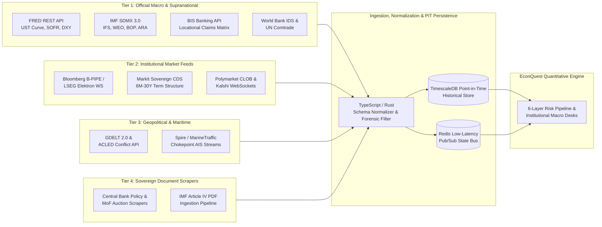

# Multi-Tier Data & Real-Time API Integration Blueprint (`docs/DATA_API_ARCHITECTURE.md`)

This document specifies the production data engineering architecture, external API connectors, normalization schemas, and Point-in-Time (PiT) storage layer required to feed **EconQuest's** 6-Layer Quantitative Risk Engine, 7-Pillar Vulnerability Scorecard, and Institutional Macro Desks with live global telemetry.

---

## 1. High-Level Data Ingestion & Normalization Topology



---

## 2. Tier 1: Official Macroeconomic & Supranational API Connectors

Tier 1 connectors ingest authoritative balance-sheet, fiscal, external debt, and bilateral banking exposure series from multilateral institutions.

### 2.1 Federal Reserve Economic Data (FRED API)
- **Base Endpoint**: `https://api.stlouisfed.org/fred/series/observations`
- **Authentication**: Server-side environment variable `FRED_API_KEY` proxied via `/api/macro/fred`.
- **Key Series Ingested**:
  - **US Treasury Benchmark Curve** (`YieldCurveMaturityDesk` risk-free baseline): `DGS1`, `DGS2`, `DGS3`, `DGS5`, `DGS7`, `DGS10`, `DGS20`, `DGS30`.
  - **Global Dollar Liquidity & Funding**: `SOFR` (Secured Overnight Financing Rate), `DTWEXBGS` (Nominal Broad U.S. Dollar Index), `TEDRATE` / Cross-currency basis proxies.
  - **Global Commodity Benchmarks**: `DCOILBRENTEU` (Brent Crude), `PCOPPUSDM` (Global Copper), `PWHEAMTUSDM` (Global Wheat).

### 2.2 International Monetary Fund (IMF SDMX 3.0 REST API)
- **Base Endpoint**: `https://dataservices.imf.org/REST/SDMX_JSON.svc/CompactData/{database}/{frequency}.{country_iso2}.{indicator}`
- **Databases & Target Indicators**:
  - **International Financial Statistics (`IFS`)**:
    - `RAFA_USD`: Total Official Reserve Assets (Gross) $\rightarrow$ feeds **Forensic Rule 1** (Shadow Reserve Haircut) and `netReservesToImportsMonths`.
    - `FPOLM_PA`: Central Bank Monetary Policy Rate $\rightarrow$ feeds `CentralBankPolicyDesk` (`currentPolicyRate`).
    - `PCPI_PC_CP_A_PT`: Headline & Core CPI Inflation YoY $\rightarrow$ feeds Taylor Rule inflation gap ($\pi_t - \pi^*$).
  - **World Economic Outlook (`WEO`)**:
    - `GGXWDG_NGDP`: General Government Gross Debt (% of GDP) $\rightarrow$ `publicDebtToGdp`.
    - `GGXONLB_NGDP`: General Government Primary Net Lending/Borrowing (% of GDP) $\rightarrow$ `primaryDeficitGap`.
    - `NGDP_RPCH`: Real GDP Growth & Output Gap estimates $\rightarrow$ `outputGapPct`.
  - **Balance of Payments (`BOP`)**:
    - Current Account Balance (% of GDP) and Direct Investment Intercompany Debt liabilities $\rightarrow$ feeds **Forensic Rule 3** (Intercompany FDI Debt Exclusion).

### 2.3 Bank for International Settlements (BIS SDMX API)
- **Base Endpoint**: `https://stats.bis.org/api/v1/data/WS_LBS_D_PUB`
- **Dataset**: **BIS Locational Banking Statistics (LBS)** & **Consolidated Banking Statistics (CBS)**.
- **Pipeline Mapping**:
  - Queries bilateral cross-border banking claims $C_{ij}$ between reporting creditor banking systems $i$ and counterparty sovereign borrowers $j$.
  - Normalizes bilateral exposure by creditor Tier-1 sovereign buffer $E_i$ to construct the live **DebtRank Contagion Adjacency Matrix** $W_{ij} = \min\left(1, \frac{C_{ij}}{E_i}\right)$ consumed by `ContagionCascadeDesk.tsx`.

### 2.4 World Bank International Debt Statistics (IDS) & UN Comtrade
- **World Bank IDS Endpoint**: `https://api.worldbank.org/v2/country/{iso3}/indicator/{series}?format=json`
  - Extracts Public and Publicly Guaranteed (PPG) external debt principal and coupon amortization schedules over $T+1 \dots T+10$ (`DT.AMT.DPPG.CD`, `DT.INT.DPPG.CD`) to populate the `YieldCurveMaturityDesk` 2026–2032 Maturity Wall.
- **UN Comtrade Bilateral Trade API**: `https://comtradeapi.un.org/public/v1/preview/C/A/HS`
  - Computes bilateral trade export shares and strategic commodity import dependencies for the trade-channel spillover weights in `ContagionCascadeDesk` and Layer 1 `commodityExportShock`.

---

## 3. Tier 2: Institutional Market & Credit Feeds

Tier 2 connectors provide sub-second credit, bond, FX, and prediction market pricing for Layer 2 Bayesian updating, Layer 3 Merton solvency, and the $\alpha_{\text{spread}}$ arbitrage scanner.

### 3.1 Bloomberg B-PIPE / Server API (`BLPAPI`) & LSEG Elektron
- **Subscription Channels**:
  - **Sovereign USD Eurobond Benchmark Yields**: Generic 1Y, 2Y, 5Y, 10Y, 30Y sovereign USD curves (fitting the Nelson-Siegel parameters $\beta_0, \beta_1, \beta_2, \lambda$ in real time).
  - **Local Currency Sovereign Bond Curves**: Domestic government bond yields to compute the Local vs. Hard Currency Lexicon Spread.
  - **FX Options Volatility Surface**: 1M and 3M 25-Delta Risk Reversals (`25D RR`) for each sovereign currency pair against USD $\rightarrow$ feeds `fxImpliedVolSkew` in Layer 2 and scales Merton asset volatility $\sigma_A$ in Layer 3.

### 3.2 S&P Market Intelligence / Markit Sovereign CDS Feed
- **Telemetry Fields**:
  - Par CDS spreads across 6M, 1Y, 2Y, 3Y, 5Y, 7Y, 10Y tenors (`cdsSpread5yBps`).
  - Upfront points (for distressed sovereigns trading on upfront points + 100/500 bps running coupon).
  - CDS-Bond Basis ($\text{Basis}_{\text{5Y}} = \text{CDS}_{\text{5Y}} - (\text{Yield}_{\text{5Y USD}} - \text{UST}_{\text{5Y}})$) consumed by `YieldCurveMaturityDesk`.

### 3.3 Prediction Market CLOB WebSockets (Polymarket & Kalshi)
- **Polymarket CLOB WebSocket**: `wss://ws-subscriptions-clob.polymarket.com/ws/market`
- **Kalshi Trade & Orderbook WebSocket**: `wss://trading-api.kalshi.com/trade-api/ws/v2`
- **Microstructure Extraction for Layer 2 & $\alpha_{\text{spread}}$**:
  - Computes mid-market implied probability $P_{\text{PM}} = \frac{\text{BestBid} + \text{BestAsk}}{2}$.
  - Integrates cumulative USDC/USD depth within $\pm 200\text{ bps}$ of the mid-price to dynamically calibrate the **Bayesian Liquidity Confidence Parameter $\tau$**:
    $$\tau = \min\left(3.0, \; \frac{\ln(1 + \text{Depth}_{\pm 2\%} / \$10,000)}{1 + 10 \cdot (\text{BestAsk} - \text{BestBid})}\right)$$
  - Streams live divergence alerts whenever $|\alpha_{\text{spread}}| = |P_{\text{calibrated}} - P_{\text{PM}}| > 2.5\%$.

---

## 4. Tier 3: Geopolitical Event Streams & Maritime AIS Telemetry

### 4.1 GDELT 2.0 Global Knowledge Graph & ACLED API
- **ACLED Endpoint**: `https://api.acleddata.com/acled/read`
  - Filters daily political violence, civil unrest, riot, and military coup indicators by ISO-3 country code.
  - Computes a 30-day exponentially weighted z-score relative to the sovereign's 5-year baseline to dynamically update Layer 1 `politicalInstabilityPitf` and Pillar 4 / Pillar 6 scores.
- **GDELT 2.0 Tone & Goldstein Scale Stream**:
  - Aggregates bilateral diplomatic conflict tone and sanctions announcements every 15 minutes.

### 4.2 Maritime AIS Chokepoint Telemetry (Spire Maritime / MarineTraffic)
- **Monitored Geospatial Bounding Boxes**:
  1. **Strait of Hormuz** (`26.56°N, 56.25°E`)
  2. **Strait of Malacca** (`2.50°N, 101.80°E`)
  3. **Bab el-Mandeb / Red Sea** (`12.58°N, 43.33°E`)
  4. **Suez Canal** (`30.58°N, 32.34°E`)
  5. **Turkish Straits (Bosporus / Dardanelles)** (`41.12°N, 29.08°E`)
  6. **Panama Canal** (`9.08°N, -79.68°W`)
  7. **Cape of Good Hope** (`-34.35°S, 18.47°E`)
- **Anomaly Detection**:
  - Tracks daily VLCC tanker, LNG carrier, and container vessel transit counts and average vessel speed anomalies.
  - If transit volume drops $>25\%$ below the 30-day moving average (or war-risk rerouting around Cape of Good Hope spikes), automatically triggers the chokepoint stress multiplier on exposed sovereigns in `WorldRiskMap.tsx` and Layer 1.

---

## 5. Tier 4: Central Bank & Sovereign Ministry Document Scraping Pipelines

### 5.1 Target Institutional Sources
- **Central Bank Communiqués & Minutes**: Federal Reserve (FOMC), ECB, Bank of Japan, plus EM central banks (BCRA Argentina, BCB Brazil, Banxico, SARB South Africa, CBRT Turkey, CBSL Sri Lanka, Bank of Ghana, SBP Pakistan, Bank Indonesia, Central Bank of Chile).
- **IMF Staff Country Reports**: Article IV Staff Reports, Extended Fund Facility (EFF) Program Reviews, and Debt Sustainability Analysis (DSA) statistical appendices (`https://www.imf.org/en/Publications/CR`).
- **Ministry of Finance Debt Management Offices (DMOs)**: Quarterly domestic treasury bill/bond auction calendars and bilateral external loan disclosures.

### 5.2 Ingestion & Change-Detection Pipeline
1. **Headless Crawler & RSS/Webhook Listener**: Polls central bank press-release feeds and IMF publication endpoints using deterministic content-hash deduplication (`SHA-256`).
2. **Layout-Aware PDF & Table Extractor**: Parses IMF Article IV statistical tables (Table: *Selected Economic and Financial Indicators* and *Gross Financing Needs*) into structured JSON while routing policy prose to the NLP Parser specified in [`docs/AI_AGENT_ARCHITECTURE.md`](./AI_AGENT_ARCHITECTURE.md).
3. **Forensic Accounting Flag Triggers**:
   - Scans footnotes in central bank balance sheet releases for **newly disclosed gold swaps**, **FX forward short books**, or **state-owned enterprise (SOE) debt assumptions**, raising an immediate analyst review flag for **Forensic Rule 1** and **Forensic Rule 3**.

---

## 6. Point-in-Time (PiT) Data Store & TypeScript Adapter Layer

### 6.1 Preventing Look-Ahead Bias via Point-in-Time (PiT) Versioning
Macroeconomic statistics (GDP, fiscal deficits, reserve adequacy) are frequently revised months after the reference period. To ensure institutional integrity in the **Basel III Kupiec & Christoffersen Backtesting Engine** (`RegulatoryBacktesting.tsx`), all ingested observations are stored in a dual-temporal TimescaleDB schema:

```sql
CREATE TABLE sovereign_telemetry_pit (
    sovereign_iso3      CHAR(3) NOT NULL,
    indicator_code      VARCHAR(64) NOT NULL,
    reference_period    DATE NOT NULL,           -- Period the macro metric measures (e.g., 2026-Q3)
    release_timestamp   TIMESTAMPTZ NOT NULL,    -- Exact UTC timestamp the market learned the number
    revision_number     SMALLINT NOT NULL DEFAULT 0,
    numeric_value       DOUBLE PRECISION NOT NULL,
    source_provider     VARCHAR(32) NOT NULL,    -- 'IMF_SDMX', 'BLOOMBERG', 'MARKIT', 'POLYMARKET'
    raw_payload_hash    CHAR(64) NOT NULL,
    PRIMARY KEY (sovereign_iso3, indicator_code, reference_period, release_timestamp)
);

-- Point-in-Time query reconstructing the exact sovereign state known at historical timestamp T_as_of:
SELECT DISTINCT ON (sovereign_iso3, indicator_code)
    sovereign_iso3, indicator_code, numeric_value, release_timestamp
FROM sovereign_telemetry_pit
WHERE release_timestamp <= $1::TIMESTAMPTZ
ORDER BY sovereign_iso3, indicator_code, release_timestamp DESC;
```

### 6.2 TypeScript Normalization Adapter (`SovereignTelemetryAdapter`)
All external API payloads are normalized on the server proxy (`/api/telemetry/*`) into the strict `SovereignEntity` interface before reaching the client:
- **Graceful Degradation & Offline Fallback**: If any external API experiences downtime or rate-limiting, the adapter seamlessly falls back to the last verified Redis snapshot or the deterministic static benchmark dataset (`src/data/sovereignData.ts`), ensuring the desk never fails to render or compute VaR.
