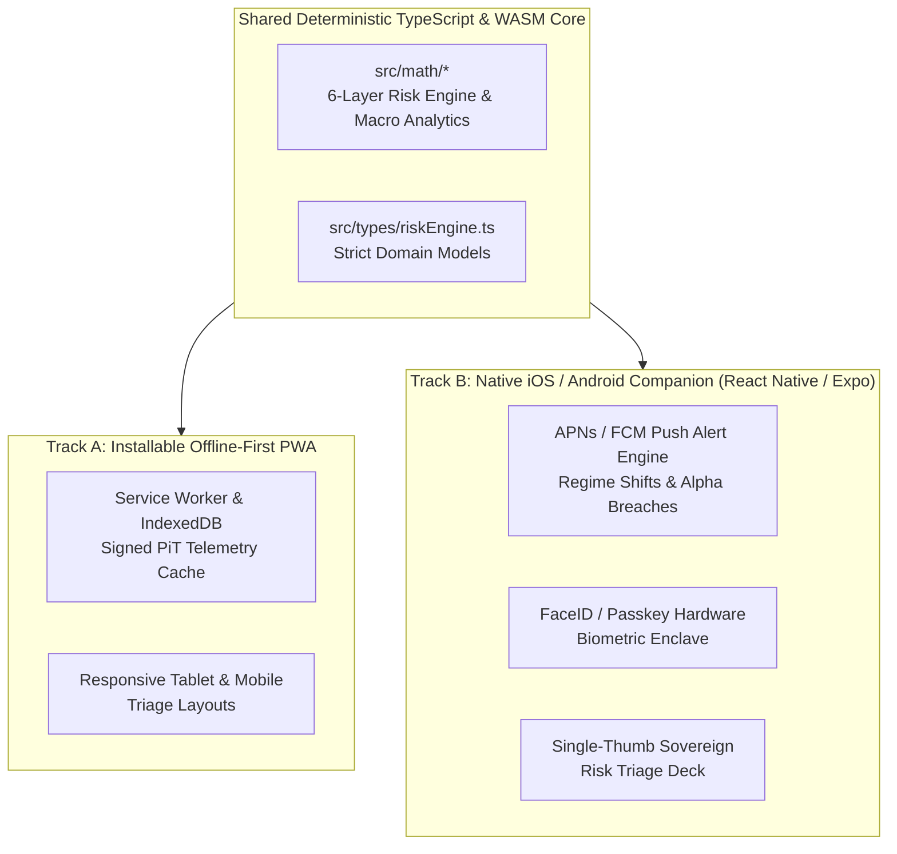

# Mobile Application, PWA & Enterprise Governance Blueprint (`docs/MOBILE_AND_ENTERPRISE_SPECS.md`)

This document specifies the mobile delivery architecture (Progressive Web App + Native iOS/Android Companion), high-performance WebAssembly compute acceleration, and **Federal Reserve SR 11-7** Model Risk Governance required to operate **EconQuest** as an enterprise institutional platform.

---

## 1. Mobile Strategy: Dual-Track PWA & Native Companion Architecture

Sovereign portfolio managers, IMF mission economists, and geopolitical risk officers require seamless access to desk telemetry across multi-monitor trading workstations, iPads in Investment Committee meetings, and smartphones during international field missions (often with degraded or zero connectivity).

---

## 2. Track A: Installable Progressive Web App (PWA) & Offline Field Mode

Because **EconQuest's** entire 6-Layer Risk Pipeline, 7-Pillar Scorecard, Nelson-Siegel Yield Curve solver, DebtRank Contagion simulator, and Student-t Copula VaR engine are written in pure, zero-dependency TypeScript (`src/math/`), 100% of the quantitative engine executes locally on the client device.

### 2.1 Offline-First Service Worker & IndexedDB Snapshot Store
1. **Static Asset & Topology Pre-Caching**:
   - The Workbox Service Worker caches the application shell, D3.js Natural Earth GeoJSON polygons (`src/data/worldGeoData.ts`), and historical crisis trajectories (`src/data/historicalMapData.ts`).
2. **Signed Point-in-Time (PiT) Telemetry Bundles**:
   - Whenever the device has network connectivity, it synchronizes a compressed, cryptographically signed JSON telemetry bundle (`~85 KB` gzipped) containing the latest sovereign fundamentals, CDS spreads, yield curve parameters, and prediction market orderbook snapshots into **IndexedDB**.
3. **Full Offline Scenario Simulation**:
   - During flights or field missions without internet access, analysts can switch scenarios (*Fed +200 bps*, *Commodity Collapse -30%*, *Malacca Blockade*, or custom shocks), scrub the 12-month historical map, simulate DebtRank cascades, and export IC Tear-Sheets with zero degradation.

### 2.2 Responsive Mobile & Tablet Viewport Adaptations
- **Tablet / iPad Pro IC Mode (`768px – 1024px`)**:
  - Collapses the persistent left sidebar into an iconic rail, switches the Dual-Pane Workspace into a stacked top/bottom split view, and optimizes the IC Tear-Sheet modal for touch annotation and AirDrop/PDF export.
- **Smartphone Triage Mode (`< 768px`)**:
  - Replaces wide multi-column tables with **Sovereign Risk Triage Cards** displaying the 5-tier traffic-light badge, 12M Posterior Hazard, 5Y CDS spread, $\alpha_{\text{spread}}$ signal badge, and a compact sparkline of the sovereign's USD yield curve.

---

## 3. Track B: Native iOS & Android Institutional Companion (`EconQuest Mobile`)

Built with **React Native (Expo)** sharing 100% of `src/math/` and `src/types/` via a monorepo workspace (`packages/quant-core`).

### 3.1 Real-Time Push Notification Engine (APNs & Firebase Cloud Messaging)
Institutional traders cannot watch every sovereign 24/7. The backend event bus evaluates incoming Tier-2 and Tier-3 telemetry against user-configured desk thresholds and dispatches low-latency push alerts:

| Alert Class | Trigger Condition | Mobile Deep-Link Action |
| :--- | :--- | :--- |
| **🚨 HMM Regime Transition** | Sovereign transitions from `Calm -> Stressed` or `Stressed -> Crisis` in Layer 4 | Opens `SovereignCockpit` with 6-Layer waterfall delta |
| **⚡ Alpha-Spread Arbitrage Breach** | $|\alpha_{\text{spread}}| = |P_{\text{calibrated}} - P_{\text{PM}}| > 250\text{ bps}$ with liquidity $\tau \ge 1.2$ | Opens Arbitrage Scanner with Polymarket/Kalshi orderbook depth |
| **📈 Curve Inversion Warning** | Sovereign 2s10s USD spread crosses below $0\text{ bps}$ (front-end distress jump) | Opens `YieldCurveMaturityDesk` with 2026–2032 Maturity Wall |
| **🏛️ Central Bank Surprise** | Actual MPC rate decision deviates $\ge 50\text{ bps}$ from Taylor Rule or consensus | Opens `CentralBankPolicyDesk` with updated real-rate & REER gap |
| **⚓ Maritime Chokepoint Alert** | AIS tanker transit volume at Hormuz, Malacca, or Bab el-Mandeb drops $>25\%$ | Opens `WorldRiskMap` focused on the affected chokepoint |

### 3.2 Hardware Security & Biometric Authentication
- **FIDO2 / WebAuthn & FaceID Enclave**: Protects proprietary portfolio positions (`PortfolioVarOptimizerDesk`) and custom stress scenarios using hardware-backed passkeys stored in the iOS Secure Enclave / Android Keystore.
- **Intune / MobileIron MDM Compliance**: Supports enterprise Mobile Device Management containerization, clipboard copy policies, and remote wipe for regulated buy-side and sell-side desks.

---

## 4. High-Performance Compute: WebWorkers & Rust/WebAssembly (WASM)

As the monitored universe scales from 10 benchmark sovereigns to **75+ global sovereign issuers** and **100,000-path Student-t Copula Monte Carlo simulations**:

1. **Dedicated Quantitative WebWorker Pool**:
   - Moves multi-sovereign copula simulations and 250-day rolling backtests off the main UI thread so D3.js map panning/zooming and Recharts animations maintain a locked `60 FPS`.
2. **Rust $\rightarrow$ WebAssembly (`wasm-bindgen` + SIMD)**:
   - Compiles the Cholesky decomposition of the $75 \times 75$ sovereign correlation matrix, Student-t random variate generators, and DebtRank matrix power iterations into SIMD-accelerated WebAssembly, achieving `< 15ms` end-to-end portfolio VaR recalculation.

---

## 5. Enterprise Governance & Regulatory Compliance (Federal Reserve SR 11-7)

Financial institutions deploying quantitative risk models for capital allocation or trading book risk must comply with **Federal Reserve SR 11-7 (Guidance on Model Risk Management)** and **Basel III FRTB (Fundamental Review of the Trading Book)**.

### 5.1 Model Inventory, Versioning & Deterministic Reproducibility
Every execution of the EconQuest risk pipeline embeds a `model_version_manifest`:
- **Semantic Model Versioning**: Any modification to logistic regression coefficients ($\beta_0 \dots \beta_6$), Bayesian log-likelihood weights ($w_{\text{CDS}}, w_{\text{FX}}, w_{\text{TSI}}$), GPD shape parameter bounds ($\xi$), or Forensic Accounting thresholds increments the semantic model version (`v2026.10.1`) and requires automated CI backtest sign-off.
- **Cryptographic Tear-Sheet Signing**: Every exported IC Tear-Sheet (JSON/CSV) includes a deterministic `SHA-256` checksum of the input `SovereignEntity` telemetry, `MacroScenario` vector, and `model_version`, guaranteeing 100% audit reproducibility years later.

### 5.2 Champion vs. Challenger Model Staging Harness
- Allows quantitative researchers to register a **Challenger Model** (e.g., an alternative Bayesian shrinkage parameter or a 3-factor Vasicek yield curve) alongside the production **Champion Model**.
- Both models run in parallel against live incoming market ticks in the **Regulatory Backtesting Desk** (`RegulatoryBacktesting.tsx`), comparing Kupiec POF p-values, Christoffersen independence statistics, and Brier probability calibration scores before promoting the Challenger to production.

### 5.3 Role-Based Access Control (RBAC) Matrix

| Desk Role | Permissions & Workspace Scope |
| :--- | :--- |
| **Sovereign Strategist / Economist** | View all desks, author custom stress scenarios, review NLP Article IV extractions, propose Forensic Accounting Rule overrides. |
| **Portfolio Manager / Trader** | Manage book notionals and CDS hedges in `PortfolioVarOptimizerDesk`, trigger IC Debate Simulator, export IC Tear-Sheets. |
| **Model Risk Officer (MRO)** | Approve/reject Forensic Rule overrides, promote Challenger models to Champion, configure Basel III backtest thresholds. |
| **Compliance / Internal Auditor** | Read-only access to Point-in-Time historical states, immutable parameter audit logs, and signed IC Tear-Sheet archives. |
